# IT305 Computer Networks Project: Master Phase-Wise Execution Roadmap
**Project:** Fault-Tolerant Topic-Based File Distribution Service  
**Academic Course:** IT305 Computer Networks Lab (Autumn 2026)  
**Institution:** Dhirubhai Ambani Institute of Information and Communication Technology (DA-IICT)  
**Academic Group:** Merged Group 071 + Group 072  
**Execution Model:** Strictly Sequential Single-Owner Engineering Chain (Zero Parallel Branches)  
**Official Assignment Deadline:** 16 October 2026 (23:59 IST)  
**Internal Quality & Code Freeze Target:** 15 October 2026 (23:59 IST)  
**Authoritative Document Status:** Active, Audited, and Frozen Single Source of Truth  

---

## 1. Executive Summary & Authoritative Source-of-Truth Hierarchy

This document serves as the **sole authoritative execution roadmap** for the design, implementation, verification, benchmarking, and packaging of the IT305 Computer Networks Lab Project: *Fault-Tolerant Topic-Based File Distribution Service*.

### 1.1 Source-of-Truth Hierarchy
Every technical requirement, wire frame structure, API signature, error behavior, and test gate in this roadmap is grounded strictly in the following hierarchy of sources:
1. **Tier 1 — Original Assignment Specification:** `IT305-lab-socket-programming-project-assignment (1).pdf` (DA-IICT Course Portal, 5 pages). Governs mandatory functionality, CLI syntax, folder layout, evaluation criteria, and submission rules.
2. **Tier 2 — Instructor Model Key & Clarifications:** `key-IT305-lab-socket-programming-project-assignment.pdf` (8 pages). Governs baseline framing paradigms, transaction flows, and sample session state models.
3. **Tier 3 — Approved Project Design Document:** `Design_Document_Group_071_072_.pdf` (46 pages, submitted 27 September 2026). Governs architectural contracts, the 16-byte fixed binary header, POSIX threading patterns, session table mutex discipline, and benchmark methodologies.
4. **Tier 4 — Active Repository Tree:** Inspected commit history and file structures in `CN-Fault-Tolerant-Topic-based-File-Distribution-Service`. Confirms file boundaries, historical drafts, and build scripts.
5. **Tier 5 — Proposed & Approved Roadmap Decisions:** Formally documented in this roadmap to resolve gaps, freeze contracts, and enforce strict sequential execution.

### 1.2 Decision Classification Discipline
Throughout this specification, all technical statements and requirements are explicitly classified into one of five categories:
- `[ASSIGNMENT-MANDATED]`: Directly specified in Tier 1 (`IT305-lab...pdf`). Non-negotiable.
- `[DESIGN-APPROVED]`: Formally documented and approved in Tier 3 (`Design_Document_Group_071_072_.pdf`). Established architectural contract.
- `[EXISTING-REPO]`: Present in the physical repository tree (Tier 4).
- `[PROPOSED-DECISION]`: A specific engineering decision introduced in this roadmap to resolve an unspecified edge case or architectural boundary, subject to team sign-off.
- `[UNRESOLVED-CONFLICT]`: A point of ambiguity or friction identified during the technical audit that requires explicit clarification or decision ownership.

---

## 2. Technical Audit of the Previous Roadmap Draft & Corrections Made

The provisional draft (`PART2_TASKS_ROADMAP.md` dated 13 Oct 2026) was subjected to a comprehensive technical audit against the authoritative documents. The audit identified five critical structural and dependency defects that would have caused integration failure. These have been corrected as follows:

| # | Previous Roadmap Defect | Authoritative Source Conflict | Root Cause / Impact | Correction Implemented in Master Roadmap |
|:---:|---|---|---|---|
| **1** | **Parallel Execution Branching**<br>(Phases 2, 3, and 4 proceeding simultaneously from Phase 1) | Violation of prompt mandate and strict single-owner sequential workflow. | Merge conflicts in shared headers (`protocol.h`, `session.h`), untested dependencies, and simultaneous edits. | **Strict Sequential Chain:** Replaced parallel branching with linear single-owner handoffs: **Phase 1 → Phase 2 → Phase 3 → Phase 4 → Phase 5 → Phase 6**. Implementation by Member $N+1$ cannot start until Member $N$ passes formal Exit Gate. |
| **2** | **Chronological Inversion of File Transfer & Client**<br>(Vivek assigned `file_transfer.*` and `Part1/client.c` in Phase 4, while Atharv built `Part2_Case1/client.c` in Phase 2) | Tier 3 Design Doc §1.4, §17: Part 1 client and file streaming are foundational prerequisites for Part 2 fault tolerance. | Atharv in Phase 2 would have had to invent file I/O and client socket logic from scratch without a baseline, while Vivek rebuilt it in Phase 4. | **Sequential Realignment:** Phase 2 assigned to **Vivek Dodiya** to build `common/file_transfer.*` and `Part1/client.c`, establishing a 100% working, verified Part 1 baseline before Part 2 begins. |
| **3** | **Split Client/Server Ownership in Case 2**<br>(Dharmraj built Case 2 Server in Phase 3; Vivek built Case 2 Client in Phase 4) | Tier 1 Assignment §Submission: Every case must have matching runnable `server` and `client` binaries. | Dharmraj could not verify the Case 2 Server exit gate without a client, forcing reliance on untested mock scripts or forward dependencies. | **Single-Owner End-to-End Ownership:** Dharmraj owns **both** `Part2_Case2/server.c` and `Part2_Case2/client.c` in Phase 4, guaranteeing complete end-to-end resume verification before handoff. |
| **4** | **Ambiguous ACK and Resume Durability Semantics**<br>(Draft did not specify write durability, dropped ACK handling, or offset alignment) | Tier 3 Design Doc §12.1–§12.4: Checkpoint invariant and authoritative server state machine. | Risk of offset regression, corrupted file chunks, and silent data truncation during reconnection under faults. | **Formal Checkpoint Contract:** Explicitly documented write ordering, `fsync`/page-cache semantics, server authoritative reconciliation, `ftruncate()` offset rewind, and fingerprint verification (§4.5 & §6). |
| **5** | **Deferred Correctness Testing**<br>(Draft deferred multi-client and regression testing entirely to Yug in Phase 6) | Tier 1 Assignment §Evaluation: Broken submissions altogether discarded; rigorous viva verification. | Integration defects discovered at the last minute would cause cascade rewrites across all phases. | **Per-Phase Independent Testing Gates:** Every phase now possesses mandatory unit, integration, and loopback verification gates with zero forward dependencies (§5). |

---

## 3. Strict Sequential Phase Dependency Model & Ownership Table

```mermaid
flowchart TD
    subgraph P1 ["PHASE 1: Foundation & Part 1 Server"]
        M1["Jay Vaghela (202401237)"]
        D1["common/protocol.*\ncommon/topic_manager.*\nPart1/server.c\nPart1/Makefile"]
        G1{"Exit Gate 1\nFraming & Server Unit Tests Passed"}
    end

    subgraph P2 ["PHASE 2: Bounded File I/O & Part 1 Client"]
        M2["Vivek Dodiya (202401253)"]
        D2["common/file_transfer.*\nPart1/client.c\nPart1 End-to-End Suite"]
        G2{"Exit Gate 2\nPart 1 Verified (diff -r 100%)"}
    end

    subgraph P3 ["PHASE 3: Fault Engine & Part 2 Case 1"]
        M3["Atharv Trivedi (202401230)"]
        D3["common/fault_injection.*\nPart2_Case1/server.c\nPart2_Case1/client.c\nPart2_Case1/Makefile"]
        G3{"Exit Gate 3\nCase 1 Full Restart Verified"}
    end

    subgraph P4 ["PHASE 4: Session State & Part 2 Case 2"]
        M4["Dharmraj Vaghela (202401236)"]
        D4["common/session.*\nPart2_Case2/server.c\nPart2_Case2/client.c\nPart2_Case2/Makefile"]
        G4{"Exit Gate 4\nCase 2 Mid-File Resume Verified"}
    end

    subgraph P5 ["PHASE 5: Parallel TCP & Case 2 Enhanced"]
        M5["Shlok Topaliya (202401229)"]
        D5["common/work_plan.*\nPart2_Case2_Enhanced/server.c\nPart2_Case2_Enhanced/client.c\nPart2_Case2_Enhanced/Makefile"]
        G5{"Exit Gate 5\nEnhanced Parallel pwrite Verified"}
    end

    subgraph P6 ["PHASE 6: Logging, Benchmarking, Report & Packaging"]
        M6["Yug Malaviya (202401256)"]
        D6["common/logging.*\nscripts/test_correctness.sh\nscripts/run_benchmarks.py\nscripts/plot_results.py\nscripts/package_submission.sh\nResults/* & FinalReport.pdf"]
        G6{"Exit Gate 6\nClean Sandbox Extraction & 100% Compliance"}
    end

    P1 ==>|Handoff Package 1| P2
    P2 ==>|Handoff Package 2| P3
    P3 ==>|Handoff Package 3| P4
    P4 ==>|Handoff Package 4| P5
    P5 ==>|Handoff Package 5| P6
```



### 3.1 Master Sequential Dependency & Deliverables Table

| Phase | Sole Owner | Student ID | Required Preceding Deliverables Consumed | Exclusive Code Artifacts Implemented | Verification Gate & Acceptance Tests | Handoff Package Deliverables | Next Phase Unlocked |
|:---:|---|:---:|---|---|---|---|:---:|
| **1** | **Jay Vaghela** | 202401237 | Authoritative Specifications (Tiers 1–3). | `common/protocol.h`<br>`common/protocol.c`<br>`common/topic_manager.h`<br>`common/topic_manager.c`<br>`Part1/server.c`<br>`Part1/Makefile` | • `gcc -Wall -Wextra -Werror` clean.<br>• Partial read/write loopback stress test.<br>• Path traversal (`../`) injection rejected.<br>• Sequential & MT server thread dispatch. | Frozen `protocol.h`, `topic_manager.h`, working `Part1/server`, test harness logs. | **Phase 2** (Vivek) |
| **2** | **Vivek Dodiya** | 202401253 | Handoff 1 (`protocol.h`, `topic_manager.h`, `Part1/server`). | `common/file_transfer.h`<br>`common/file_transfer.c`<br>`Part1/client.c`<br>`Part1/Makefile` (updated) | • Bounded 64 KB chunk file streaming.<br>• `Part1/client` connects and fetches topic.<br>• `diff -r` bit-exact match against source.<br>• Multi-client concurrency test (8 clients). | Frozen `file_transfer.h`, complete working `Part1/` suite, SHA256 integrity logs. | **Phase 3** (Atharv) |
| **3** | **Atharv Trivedi** | 202401230 | Handoff 2 (`protocol.h`, `topic_manager.h`, `file_transfer.h`, `Part1/`). | `common/fault_injection.h`<br>`common/fault_injection.c`<br>`Part2_Case1/server.c`<br>`Part2_Case1/client.c`<br>`Part2_Case1/Makefile` | • Probabilistic fault injection ($0.0 \le p \le 1.0$).<br>• Server abrupt socket closure.<br>• Client disconnect detection & folder purge.<br>• Full topic restart from File 0, Offset 0.<br>• Eventual bit-exact completion. | Frozen `fault_injection.h`, complete working `Part2_Case1/` suite, fault injection test log. | **Phase 4** (Dharmraj) |
| **4** | **Dharmraj Vaghela** | 202401236 | Handoff 3 (`protocol.h`, `topic_manager.h`, `file_transfer.h`, `fault_injection.h`, `Part2_Case1/`). | `common/session.h`<br>`common/session.c`<br>`Part2_Case2/server.c`<br>`Part2_Case2/client.c`<br>`Part2_Case2/Makefile` | • Thread-safe session table with mutex.<br>• Per-chunk `CHUNK_ACK` commit pipeline.<br>• Reconnect with `SESSION_RESUME`.<br>• Authoritative offset rewind (`ftruncate`).<br>• Mid-file resume verified with zero retransmissions. | Frozen `session.h`, complete working `Part2_Case2/` suite, resume test traces. | **Phase 5** (Shlok) |
| **5** | **Shlok Topaliya** | 202401229 | Handoff 4 (`protocol.h`, `topic_manager.h`, `file_transfer.h`, `fault_injection.h`, `session.h`, `Part2_Case2/`). | `common/work_plan.h`<br>`common/work_plan.c`<br>`Part2_Case2_Enhanced/server.c`<br>`Part2_Case2_Enhanced/client.c`<br>`Part2_Case2_Enhanced/Makefile` | • Non-overlapping range partition.<br>• Multi-socket TCP pool (2–4 connections).<br>• Thread-safe concurrent `pwrite()`.<br>• Single-socket fault isolation & unit reassignment.<br>• CLI defaults to 1 connection when omitted. | Frozen `work_plan.h`, complete working `Part2_Case2_Enhanced/` suite, parallel logs. | **Phase 6** (Yug) |
| **6** | **Yug Malaviya** | 202401256 | Handoff 5 (All 4 working implementations: `Part1/`, `Part2_Case1/`, `Part2_Case2/`, `Part2_Case2_Enhanced/`). | `common/logging.h`<br>`common/logging.c`<br>`scripts/test_correctness.sh`<br>`scripts/run_benchmarks.py`<br>`scripts/plot_results.py`<br>`scripts/package_submission.sh`<br>`Results/*`<br>`FinalReport_Group_071_072.pdf`<br>`README.md` | • Thread-safe monotonic logger.<br>• Automated 4-directory correctness harness.<br>• Full benchmark execution across matrix.<br>• 4 publication-quality PNG plots.<br>• Report with cover page & authentic data.<br>• Archive extracts & compiles in clean sandbox. | Consolidated submission archive `FinalSubmission_Group_071_072.tar.gz`, verified ready for submission. | **Official Submission** |

---

## 4. Cross-Phase Interface & Protocol Contracts

### 4.1 Wire Protocol Specification `[DESIGN-APPROVED: §6.1]`
The application protocol runs directly on POSIX stream sockets over TCP. It strictly enforces message framing using a fixed 16-byte binary frame header followed by an explicit payload.

#### 4.1.1 Fixed 16-Byte Binary Frame Structure
```c
/* common/protocol.h */
#ifndef PROTOCOL_H
#define PROTOCOL_H

#include <stdint.h>
#include <stddef.h>

#define PROTOCOL_MAGIC 0x5446  /* ASCII 'T', 'F' (Topic File) */
#define PROTOCOL_VERSION 0x01
#define DEFAULT_CHUNK_SIZE (64 * 1024) /* 64 KB bounded file chunk */

typedef struct __attribute__((packed)) {
    uint16_t magic;        /* 0x00-0x01: Must match PROTOCOL_MAGIC (0x5446) */
    uint8_t  version;      /* 0x02:      Must match PROTOCOL_VERSION (0x01) */
    uint8_t  type;         /* 0x03:      Message Type identifier (MessageType enum) */
    uint16_t flags;        /* 0x04-0x05: Bitwise flags (e.g., FLAG_CONFLICT, FLAG_LAST) */
    uint16_t reserved;     /* 0x06-0x07: Reserved padding, must be 0x0000 */
    uint64_t payload_len;  /* 0x08-0x0F: Length of following payload in bytes (network endian) */
} FrameHeader;
```

#### 4.1.2 Byte Order & Endianness Rules
- Multi-byte integer fields in `FrameHeader` and binary payloads must be encoded in **Network Byte Order (Big-Endian)** before transmission.
- 16-bit fields: `htons()` and `ntohs()`.
- 32-bit fields: `htonl()` and `ntohl()`.
- 64-bit fields: `htobe64()` and `be64toh()` (standard in `<endian.h>`).

#### 4.1.3 Message Type Registry
```c
typedef enum {
    /* Baseline Protocol (Part 1 & Part 2 Case 1) */
    MSG_GET              = 0x01, /* Client -> Server: Request topic transfer */
    MSG_TOPIC_OK         = 0x02, /* Server -> Client: Topic accepted, sends file count & manifest */
    MSG_TOPIC_ERROR      = 0x03, /* Server -> Client: Topic invalid, not found, or traversal rejected */
    MSG_FILE_BEGIN       = 0x04, /* Server -> Client: Metadata for upcoming file stream */
    MSG_FILE_DATA        = 0x05, /* Server -> Client: Bounded raw binary file payload chunk */
    MSG_FILE_END         = 0x06, /* Server -> Client: Boundary confirming file stream complete */
    MSG_TRANSFER_END     = 0x07, /* Server -> Client: Signals entire topic transfer finished */

    /* Case 2 Session Management */
    MSG_SESSION_START    = 0x08, /* Client -> Server: Initiate new stateful session */
    MSG_SESSION_ACCEPT   = 0x09, /* Server -> Client: Return assigned session ID & fingerprint */
    MSG_CHUNK_ACK        = 0x0A, /* Client -> Server: Acknowledge chunk written to local disk */
    MSG_SESSION_RESUME   = 0x0B, /* Client -> Server: Request resumption with local checkpoint */
    MSG_RESUME_ACCEPT    = 0x0C, /* Server -> Client: Authoritative resumption point approved */
    MSG_RESUME_ERROR     = 0x0D, /* Server -> Client: Resume rejected (fingerprint mismatch/expired) */

    /* Case 2 Enhanced Parallel Connections */
    MSG_WORK_PLAN        = 0x0E, /* Server -> Client: Partition plan for parallel workers */
    MSG_WORK_ASSIGN      = 0x0F, /* Server -> Client: Assign specific unit (file/range) to connection */
    MSG_WORK_DATA        = 0x10, /* Server -> Client: Positional data chunk for assigned unit */
    MSG_WORK_END         = 0x11, /* Server -> Client: Work unit completed */

    /* General Control */
    MSG_ERROR            = 0x1E, /* Bidirectional: General protocol violation or error */
    MSG_CLOSE            = 0x1F  /* Bidirectional: Clean connection termination */
} MessageType;
```

#### 4.1.4 Binary Payload Structs `[DESIGN-APPROVED: §6.2–§6.5]`
```c
/* MSG_GET payload */
typedef struct __attribute__((packed)) {
    char topic[128];               /* Null-terminated topic directory name */
} MsgGetPayload;

/* MSG_TOPIC_OK payload */
typedef struct __attribute__((packed)) {
    uint32_t file_count;           /* Total number of regular files in topic */
    uint32_t manifest_fingerprint; /* CRC32/Adler32 hash of sorted file names + sizes */
    uint64_t total_topic_bytes;    /* Sum of all file sizes in bytes */
} MsgTopicOkPayload;

/* MSG_TOPIC_ERROR payload */
typedef struct __attribute__((packed)) {
    uint32_t error_code;           /* 404: Not Found, 403: Security Violation */
    char error_msg[256];           /* Human-readable diagnostic message */
} MsgTopicErrorPayload;

/* MSG_FILE_BEGIN payload */
typedef struct __attribute__((packed)) {
    uint32_t file_index;           /* 0-based lexicographical index */
    uint64_t file_size;            /* Total file size in bytes */
    uint64_t start_offset;         /* Offset from which server starts sending (0 or resume) */
    char filename[256];            /* File name without directories */
} MsgFileBeginPayload;

/* MSG_FILE_END payload */
typedef struct __attribute__((packed)) {
    uint32_t file_index;           /* Confirmed file index */
    uint64_t final_offset;         /* Offset reached upon completion */
} MsgFileEndPayload;

/* MSG_SESSION_START payload */
typedef struct __attribute__((packed)) {
    char topic[128];               /* Requested topic */
    uint32_t requested_conns;      /* Requested parallel TCP connections (1 for default) */
} MsgSessionStartPayload;

/* MSG_SESSION_ACCEPT payload */
typedef struct __attribute__((packed)) {
    uint64_t session_id;           /* Random 64-bit non-zero session ID */
    uint32_t manifest_fingerprint; /* Manifest integrity fingerprint */
    uint32_t file_count;           /* Total topic files */
} MsgSessionAcceptPayload;

/* MSG_CHUNK_ACK payload */
typedef struct __attribute__((packed)) {
    uint64_t session_id;           /* Active session ID */
    uint32_t file_index;           /* File index of chunk */
    uint64_t end_offset;           /* Byte offset reached in file after writing chunk */
    uint32_t seq_num;              /* Chunk sequence number */
} MsgChunkAckPayload;

/* MSG_SESSION_RESUME payload */
typedef struct __attribute__((packed)) {
    uint64_t session_id;           /* Previous session ID */
    char topic[128];               /* Topic name verification */
    uint32_t manifest_fingerprint; /* Local stored manifest fingerprint */
    uint32_t proposed_file_index;  /* Client's last acknowledged file index */
    uint64_t proposed_file_offset; /* Client's last acknowledged byte offset */
} MsgSessionResumePayload;

/* MSG_RESUME_ACCEPT payload */
typedef struct __attribute__((packed)) {
    uint64_t session_id;           /* Active session ID */
    uint32_t authoritative_file_idx;    /* Server's authoritative resume file index */
    uint64_t authoritative_file_offset; /* Server's authoritative resume byte offset */
    uint16_t resume_flags;              /* Bit 0: 1 = Conflict/Rewind forced */
} MsgResumeAcceptPayload;
```

### 4.2 Shared Module Contracts & Invariants

#### 4.2.1 `common/protocol.*` Contract
- **Owner:** Jay Vaghela (Phase 1).
- **Public Functions:**
  - `int send_all(int fd, const void *buf, size_t len)`: Loops `send()` until `len` bytes transmitted; handles `EINTR`; returns 0 on success, -1 on fatal error.
  - `int recv_all(int fd, void *buf, size_t len)`: Loops `recv()` until `len` bytes filled; returns 0 on success, -1 on error, 1 on clean remote EOF.
  - `int send_frame(int fd, uint8_t type, uint16_t flags, const void *payload, uint64_t payload_len)`: Prepares `FrameHeader`, packs network endianness, transmits header followed by payload.
  - `int recv_frame_header(int fd, FrameHeader *hdr)`: Reads 16 bytes via `recv_all()`; validates magic `0x5446` and version `0x01`; converts `payload_len` to host order.
  - `int recv_frame_payload(int fd, const FrameHeader *hdr, void *buf, size_t max_buf_size)`: Safely reads `hdr->payload_len` into `buf`, returning error if payload exceeds `max_buf_size`.

#### 4.2.2 `common/topic_manager.*` Contract
- **Owner:** Jay Vaghela (Phase 1).
- **Public Functions:**
  - `int validate_topic_name(const char *topic)`: Rejects path traversal (`..`), slashes (`/`, `\`), null characters, and empty strings.
  - `int build_topic_manifest(const char *root_dir, const char *topic, TopicManifest **out_manifest)`: Reads topic directory with `opendir()`/`readdir()`; filters regular files (`stat()`, `S_ISREG`); sorts filenames lexicographically via `qsort()`; computes CRC32 manifest fingerprint.
  - `void free_topic_manifest(TopicManifest *manifest)`: Cleanly deallocates manifest memory.

#### 4.2.3 `common/file_transfer.*` Contract
- **Owner:** Vivek Dodiya (Phase 2).
- **Public Functions:**
  - `int open_file_for_streaming(const char *path, uint64_t offset, int *out_fd)`: Opens file with `O_RDONLY`; calls `lseek(fd, offset, SEEK_SET)`.
  - `int open_file_for_writing(const char *path, int *out_fd)`: Creates/opens destination file with `O_WRONLY | O_CREAT`, mode `0644`.
  - `int write_chunk_to_file(int fd, const void *buf, size_t len)`: Executes bounded `write()` loop; returns 0 on complete write, -1 on failure.
  - `int sync_file_to_disk(int fd)`: Calls `fdatasync(fd)` or `fsync(fd)` to flush OS buffers.
  - `int truncate_and_seek(int fd, uint64_t target_offset)`: Calls `ftruncate(fd, target_offset)` and `lseek(fd, target_offset, SEEK_SET)`.

#### 4.2.4 `common/fault_injection.*` Contract
- **Owner:** Atharv Trivedi (Phase 3).
- **Public Functions:**
  - `int init_fault_injection(double failure_prob, unsigned int seed)`: Validates $0.0 \le p \le 1.0$; initializes thread-safe PRNG state.
  - `int should_inject_fault(void)`: Evaluates probabilistic event before sending next data chunk; returns 1 (drop) or 0 (continue).
  - `void execute_fault_disconnect(int socket_fd, const char *context_msg)`: Logs disconnection event; calls `close(socket_fd)` immediately without sending termination frames.

#### 4.2.5 `common/session.*` Contract
- **Owner:** Dharmraj Vaghela (Phase 4).
- **Public Functions:**
  - `int session_table_init(int max_sessions)`: Initializes global table and `pthread_mutex_t session_table_mutex`.
  - `SessionState* session_create(const char *topic, uint32_t fingerprint, uint32_t file_count)`: Generates 64-bit random ID; registers session in table under lock.
  - `SessionState* session_lookup(uint64_t session_id)`: Searches active table under lock; returns pointer or NULL.
  - `int session_commit_chunk(uint64_t session_id, uint32_t file_idx, uint64_t end_offset, uint32_t seq)`: Validates sequential progression; atomically updates checkpoint under lock.
  - `int session_validate_resume(uint64_t session_id, const char *topic, uint32_t fingerprint, uint32_t prop_file, uint64_t prop_offset, uint32_t *auth_file, uint64_t *auth_offset, uint16_t *flags)`: Enforces server authority; prevents offset regression; flags conflicts.
  - `void session_cleanup_stale(int ttl_seconds)`: Sweeps expired sessions under lock.

#### 4.2.6 `common/work_plan.*` Contract
- **Owner:** Shlok Topaliya (Phase 5).
- **Public Functions:**
  - `int create_work_plan(const TopicManifest *manifest, int num_conns, WorkPlan **out_plan)`: Partitions topic into discrete `WorkUnit`s (file-level or byte-range level); ensures non-overlapping byte ranges.
  - `WorkUnit* get_next_work_unit(WorkPlan *plan, int worker_id)`: Dispatches idle unit under `work_plan_mutex`.
  - `int mark_work_unit_failed(WorkPlan *plan, uint32_t unit_id)`: Flags unit failed for reassignment upon connection loss.
  - `int mark_work_unit_complete(WorkPlan *plan, uint32_t unit_id)`: Records completed unit; checks topic completion.

#### 4.2.7 `common/logging.*` Contract
- **Owner:** Yug Malaviya (Phase 6).
- **Public Functions:**
  - `void log_event(LogLevel level, const char *module, const char *fmt, ...)`: Thread-safe timestamped stderr logging protected by `logging_mutex`.
  - `void record_benchmark_metric(const BenchmarkRecord *record, const char *csv_path)`: Appends structured metric row to CSV.
  - `uint64_t get_monotonic_time_ns(void)`: Returns `CLOCK_MONOTONIC` nanoseconds for high-precision timing.

### 4.3 Command-Line Interface (CLI) Specifications `[ASSIGNMENT-MANDATED: §Standard CLI]`
Deviating from this interface will fail auto-grading. All arguments are positional.

| Executable Path | Invocation Syntax | Argument Definitions & Validation Rules |
|---|---|---|
| `Part1/server` | `./server <port> <topics_root_dir>` | • `<port>`: Integer in range `1024–65535`.<br>• `<topics_root_dir>`: Path to directory containing topic sub-folders. |
| `Part1/client` | `./client <server_ip> <server_port> <topic> <output_dir>` | • `<server_ip>`: Valid IPv4 address.<br>• `<server_port>`: Valid server port.<br>• `<topic>`: Directory name in topics root.<br>• `<output_dir>`: Destination path; writes into `<output_dir>/<topic>/`. |
| `Part2_Case1/server` | `./server <port> <topics_root_dir> <failure probability>` | • `<failure probability>`: Float in range `[0.0, 1.0]`. |
| `Part2_Case1/client` | `./client <server_ip> <server_port> <topic> <output_dir>` | Same standard 4-argument client interface. Purges folder and restarts upon failure. |
| `Part2_Case2/server` | `./server <port> <topics_root_dir> <failure probability>` | Same 3-argument server interface. Maintains session table and checkpoints. |
| `Part2_Case2/client` | `./client <server_ip> <server_port> <topic> <output_dir>` | Same 4-argument client interface. Reconnects and resumes from checkpoint. |
| `Part2_Case2_Enhanced/server`| `./server <port> <topics_root_dir> <failure probability>` | Same 3-argument server interface. Coordinates multi-socket parallel streams. |
| `Part2_Case2_Enhanced/client`| `./client <server_ip> <server_port> <topic> <output_dir> [num_connections]` | • Standard 4 arguments required.<br>• `[num_connections]`: Optional 5th argument (integer `1–16`). **Defaults strictly to 1** if omitted to guarantee 100% auto-grader compliance. |

### 4.4 Contract-Freeze & Change-Control Procedure
1. **Freeze Milestone:** Upon completion of Phase 1, `protocol.h` and `topic_manager.h` are marked **FROZEN v1.0**.
2. **Immutable Rule:** No subsequent phase owner may alter the binary frame header structure, message IDs, or function signatures in earlier frozen headers without an approved formal RFC.
3. **Change-Request Process:** If an edge case requires header modification:
   - Author files an RFC detailing: (a) Reason, (b) Affected modules, (c) Backward compatibility impact.
   - Requires unanimous approval by all 6 members.
   - The original phase owner makes the change, bumps the contract version, and re-executes all preceding phase exit tests.

---

## 5. Detailed Implementation Specifications by Phase

---

### Phase 1: Wire Protocol Framing & Topic Manifest Engine & Part 1 Server
- **Phase Number:** 1
- **Sole Owner:** **Jay Vaghela** (Student ID: 202401237)
- **Objective:** Establish the core binary wire framing subsystem, directory scanning with path traversal security, and the Part 1 baseline server in both sequential and multi-threaded modes.
- **Traceability:** Tier 1 Assignment §Part 1; Tier 2 Key §Page 2–3; Tier 3 Design Doc §5.1, §5.2, §6.1, §6.2, §7.1, §7.2.
- **Rationale for Sequence:** Foundation phase. All network communication across all 4 project cases relies on the 16-byte binary framing engine and topic directory scanner. Must be fully verified before file transfer or client logic can be built.

#### Entry Conditions
- Master Roadmap reviewed and agreed upon by all 6 team members.
- Verification that POSIX development environment (`gcc`, `make`, `pthread`) is operational.

#### File Ownership Boundaries
- `common/protocol.h` (New, Sole Owner)
- `common/protocol.c` (New, Sole Owner)
- `common/topic_manager.h` (New, Sole Owner)
- `common/topic_manager.c` (New, Sole Owner)
- `Part1/server.c` (New, Sole Owner)
- `Part1/Makefile` (New, Sole Owner)
- `tests/test_phase1.c` (New, Sole Owner, Test Harness)

#### Detailed Tasks

##### Task 1.1: 16-Byte Binary Protocol Framing Subsystem
- **Objective:** Implement byte-level framing routines handling partial TCP reads, partial writes, and network endianness conversions.
- **Files:** `common/protocol.h`, `common/protocol.c`.
- **Implementation Sequence:**
  1. Define packed `FrameHeader` structure and `MessageType` enums matching §4.1.
  2. Implement `send_all(int fd, const void *buf, size_t len)` with `EINTR` retry loop.
  3. Implement `recv_all(int fd, void *buf, size_t len)` with partial-read buffer tracking and EOF detection.
  4. Implement `send_frame()` and `recv_frame_header()` / `recv_frame_payload()`.
  5. Enforce 64-bit integer endianness conversion (`htobe64()` / `be64toh()`).
- **Edge Cases & Error Handling:** Remote socket closed mid-header (return -1/EOF); received magic number mismatch (reject frame with error code); payload exceeds maximum buffer limit (drain socket and drop connection).

##### Task 1.2: Topic Discovery & Directory Traversal Security Engine
- **Objective:** Implement safe topic directory traversal, regular-file filtering, and deterministic lexicographical manifest generation.
- **Files:** `common/topic_manager.h`, `common/topic_manager.c`.
- **Implementation Sequence:**
  1. Implement `validate_topic_name()`: Check for `..`, `/`, `\`, null bytes, and hidden files (`.`).
  2. Implement `build_topic_manifest()`: Construct full path `<root>/<topic>`, invoke `opendir()`, read entries via `readdir()`.
  3. For each entry, invoke `stat()`: filter strictly for `S_ISREG` (reject subdirectories, pipes, sockets, and symlinks).
  4. Sort `files[]` array lexicographically using `qsort()` and `strcmp()` to guarantee identical file ordering across all client connections.
  5. Compute 32-bit manifest fingerprint (CRC32 over concatenated sorted filenames and sizes).
- **Edge Cases & Error Handling:** Non-existent topic directory (return `TOPIC_NOT_FOUND`); directory containing zero regular files (return empty manifest, `file_count = 0`); attempt to access `/etc/passwd` via `GET ../../etc/passwd` (return `TOPIC_ERROR`).

##### Task 1.3: Part 1 Baseline Server Architecture
- **Objective:** Implement the Part 1 server supporting both sequential and multi-threaded client handling using the frozen protocol.
- **Files:** `Part1/server.c`, `Part1/Makefile`.
- **Implementation Sequence:**
  1. Parse CLI arguments strictly matching `./server <port> <topics_root_dir>`.
  2. Create TCP socket, set `SO_REUSEADDR`, bind to port, and invoke `listen()`.
  3. Implement main listener loop:
     - For each `accept()` connection, dispatch request processing.
     - Multi-threaded mode: spawn detached POSIX thread (`pthread_create(&tid, NULL, worker_func, client_ctx)`).
     - Worker thread: receive `MSG_GET`, parse topic name, call `build_topic_manifest()`.
     - If invalid: transmit `MSG_TOPIC_ERROR` and close socket.
     - If valid: transmit `MSG_TOPIC_OK` containing `file_count` and manifest fingerprint.
     - Iterate through manifest files: send `MSG_FILE_BEGIN`, stream chunks via `MSG_FILE_DATA`, send `MSG_FILE_END`.
     - After all files: transmit `MSG_TRANSFER_END` and cleanly close socket.
- **Makefile Requirements:** Compile with `-Wall -Wextra -Werror -pedantic -pthread -I../common`.

#### Phase 1 Verification & Acceptance Tests
- **Test 1.1 (Build Cleanliness):** `cd Part1 && make clean && make` produces executable `server` with zero warnings.
- **Test 1.2 (Framing Stress Test):** Run `tests/test_phase1 framing` to transmit 10,000 frames of random lengths (1 byte to 1 MB) over loopback socket; verify bit-exact frame recovery.
- **Test 1.3 (Path Traversal Security):** Run mock client sending `GET ../../` and `GET /etc/shadow`; verify server responds with `MSG_TOPIC_ERROR` and closes connection without segfault.
- **Test 1.4 (Thread Concurrency):** Connect 10 simultaneous mock clients querying topic `cane`; verify server spawns 10 threads, accepts all, and logs zero deadlocks or crashes.

#### Exit Gate & Handoff Package 1
- **Exit Gate:** All 4 tests pass; zero memory leaks reported under Valgrind; `protocol.h` and `topic_manager.h` frozen.
- **Handoff Deliverables to Vivek:**
  1. Frozen `common/protocol.h` and `common/protocol.c`.
  2. Frozen `common/topic_manager.h` and `common/topic_manager.c`.
  3. Working `Part1/server` binary and source.
  4. Test log `tests/phase1_verification.log` documenting clean build and framing correctness.
  5. Explicit handoff note detailing server packet transmission order (`TOPIC_OK` → `FILE_BEGIN` → `FILE_DATA`... → `FILE_END` → `TRANSFER_END`).

---

### Phase 2: Bounded File Streaming Engine & Part 1 Baseline Client
- **Phase Number:** 2
- **Sole Owner:** **Vivek Dodiya** (Student ID: 202401253)
- **Objective:** Implement the bounded chunked file I/O engine, the Part 1 baseline client, and achieve 100% bit-exact end-to-end file distribution against Jay's Part 1 server.
- **Traceability:** Tier 1 Assignment §Part 1; Tier 2 Key §Page 3; Tier 3 Design Doc §8.1, §8.2, §9.1, §9.2.
- **Rationale for Sequence:** Must follow Phase 1 because client socket I/O depends on `protocol.h` and must interact with `Part1/server`. Must precede Phase 3 because Part 2 fault tolerance is layered directly on top of a working, verified Part 1 client and file streaming engine.

#### Entry Conditions
- Acceptance of Handoff Package 1 from Jay Vaghela.
- Successful local build and execution of `Part1/server`.

#### File Ownership Boundaries
- `common/file_transfer.h` (New, Sole Owner)
- `common/file_transfer.c` (New, Sole Owner)
- `Part1/client.c` (New, Sole Owner)
- `Part1/Makefile` (Shared with Jay; Vivek adds `client` target)
- `tests/test_phase2.sh` (New, Sole Owner, End-to-End Test Script)

#### Detailed Tasks

##### Task 2.1: Bounded File I/O Engine (`common/file_transfer.*`)
- **Objective:** Implement chunked file reading, bounded writing, directory tree creation, and file truncation without buffering whole files into RAM.
- **Files:** `common/file_transfer.h`, `common/file_transfer.c`.
- **Implementation Sequence:**
  1. Implement `create_directory_recursive(const char *dir_path)`: Uses `mkdir()` with mode `0755` to safely create `<output_dir>/<topic>/`.
  2. Implement `open_file_for_streaming()` and `open_file_for_writing()`.
  3. Implement `write_chunk_to_file()`: Writes chunk of up to `DEFAULT_CHUNK_SIZE` (64 KB) to file descriptor; handles partial disk writes.
  4. Implement `sync_file_to_disk()`: Invokes `fsync(fd)` to guarantee page cache flush.
  5. Implement `truncate_and_seek()`: Uses `ftruncate(fd, offset)` and `lseek(fd, offset, SEEK_SET)`.
- **Edge Cases & Error Handling:** Destination disk full (return `ENOSPC`, abort gracefully); missing parent directories (recursively create path); destination file already exists (truncate to zero on initial download).

##### Task 2.2: Part 1 Baseline Client Implementation (`Part1/client.c`)
- **Objective:** Implement the standard Part 1 client connecting to the server, requesting a topic, receiving all files, and verifying topic integrity.
- **Files:** `Part1/client.c`, `Part1/Makefile`.
- **Implementation Sequence:**
  1. Parse CLI arguments strictly matching `./client <server_ip> <server_port> <topic> <output_dir>`.
  2. Resolve server address using `inet_pton()`, create TCP socket, and call `connect()`.
  3. Send `MSG_GET` with `topic` payload.
  4. Receive response frame:
     - If `MSG_TOPIC_ERROR`: display error message and exit cleanly with code 1.
     - If `MSG_TOPIC_OK`: parse `file_count` and total bytes; invoke `create_directory_recursive()` to construct destination path `<output_dir>/<topic>/`.
  5. Receive file loop:
     - Await `MSG_FILE_BEGIN`: extract `filename`, `file_size`; open destination file `<output_dir>/<topic>/<filename>`.
     - In loop, await `MSG_FILE_DATA`: call `write_chunk_to_file()` for each incoming chunk until cumulative bytes reach `file_size`.
     - Await `MSG_FILE_END`: close file descriptor, verify bytes written match `file_size`.
  6. Await `MSG_TRANSFER_END`: print summary (files received, total bytes) and exit cleanly with code 0.
- **Makefile Requirements:** Update `Part1/Makefile` to produce both `server` and `client` executables upon running `make`.

#### Phase 2 Verification & Acceptance Tests
- **Test 2.1 (Build Cleanliness):** `cd Part1 && make clean && make` produces both `server` and `client`.
- **Test 2.2 (End-to-End Distribution):** Run `Part1/server` on port 9001 with sample dataset (`animals10/cane`); run `Part1/client 127.0.0.1 9001 cane ./downloads`; verify all files download.
- **Test 2.3 (Bit-Exact Integrity Check):** Execute `diff -r ./dataset/cane ./downloads/cane`; must output **zero diffs** (100% bit-exact SHA256 match).
- **Test 2.4 (Multi-Client Baseline):** Execute 4 simultaneous clients requesting topics `cane`, `gatto`, `cavallo`, `elefante` concurrently; verify all 4 complete with zero corruptions.

#### Exit Gate & Handoff Package 2
- **Exit Gate:** All tests pass; `diff -r` confirms 100% integrity; `Part1/` fully compliant with Tier 1 CLI; `file_transfer.h` frozen.
- **Handoff Deliverables to Atharv:**
  1. Frozen `common/file_transfer.h` and `common/file_transfer.c`.
  2. Complete working `Part1/` directory (`server.c`, `client.c`, `Makefile`).
  3. Test report `tests/phase2_integrity_report.txt` confirming SHA256 checksum match across dataset images.
  4. Handoff note explaining client event loop and file creation semantics.

---

### Phase 3: Fault Injection Engine & Part 2 Case 1 End-to-End
- **Phase Number:** 3
- **Sole Owner:** **Atharv Trivedi** (Student ID: 202401230)
- **Objective:** Implement the probabilistic socket fault injection engine, the Case 1 fault-injecting multi-threaded server, and the Case 1 restart-from-beginning client.
- **Traceability:** Tier 1 Assignment §Part II & §Case 1; Tier 2 Key §Page 4–5; Tier 3 Design Doc §10.1, §10.2, §11.1, §11.2.
- **Rationale for Sequence:** Must follow Phase 2 because Case 1 is a direct extension of the working Part 1 client and server. Must precede Phase 4 because Case 2's session management requires the same fault injection engine to trigger mid-transfer disconnections.

#### Entry Conditions
- Acceptance of Handoff Package 2 from Vivek Dodiya.
- Verified that `Part1/server` and `Part1/client` run and pass `diff -r` on Atharv's local workstation.

#### File Ownership Boundaries
- `common/fault_injection.h` (New, Sole Owner)
- `common/fault_injection.c` (New, Sole Owner)
- `Part2_Case1/server.c` (New, Sole Owner)
- `Part2_Case1/client.c` (New, Sole Owner)
- `Part2_Case1/Makefile` (New, Sole Owner)
- `tests/test_phase3.sh` (New, Sole Owner)

#### Detailed Tasks

##### Task 3.1: Probabilistic Fault Injection Engine (`common/fault_injection.*`)
- **Objective:** Implement configurable probabilistic connection termination that simulates network drops before data chunk transmission.
- **Files:** `common/fault_injection.h`, `common/fault_injection.c`.
- **Implementation Sequence:**
  1. Implement `init_fault_injection(double failure_prob, unsigned int seed)`.
  2. Validate CLI `<failure probability>` argument: strictly enforce `0.0 <= p <= 1.0`. Reject negative, non-numeric, or `> 1.0` inputs.
  3. Implement `should_inject_fault()`:
     - Uses thread-safe `rand_r()` or a seeded PRNG.
     - Compares `(double)rand_r(&seed) / RAND_MAX < failure_prob`.
  4. Implement `execute_fault_disconnect(int socket_fd, const char *ctx)`:
     - Logs disconnect event to stderr (topic, active file, byte offset, timestamp).
     - Immediately calls `close(socket_fd)` without sending termination frames.
- **Edge Cases & Error Handling:** `failure_prob = 0.0` (faults never injected); `failure_prob = 1.0` (fault injected on first eligible chunk).

##### Task 3.2: Part 2 Case 1 Server (`Part2_Case1/server.c`)
- **Objective:** Multi-threaded server that probabilistically terminates active client connections and retains zero session state.
- **Files:** `Part2_Case1/server.c`, `Part2_Case1/Makefile`.
- **Implementation Sequence:**
  1. Parse CLI: `./server <port> <topics_root_dir> <failure probability>`.
  2. Spawn one detached POSIX thread per accepted client connection.
  3. When client issues `MSG_GET`, build manifest and begin streaming files.
  4. **Fault Injection Point:** Before sending each `MSG_FILE_DATA` chunk, call `should_inject_fault()`.
  5. If fault triggered:
     - Call `execute_fault_disconnect()`.
     - Close socket, free thread-local memory, and terminate thread (`pthread_exit(NULL)`).
  6. Server maintains **zero session state**: any subsequent reconnect by the client is handled as a brand-new, independent request starting from File 0, Offset 0.

##### Task 3.3: Part 2 Case 1 Client (`Part2_Case1/client.c`)
- **Objective:** Client that detects connection failure, purges incomplete downloads, reconnects, and restarts the topic transfer entirely from scratch.
- **Files:** `Part2_Case1/client.c`, `Part2_Case1/Makefile`.
- **Implementation Sequence:**
  1. Parse CLI: `./client <server_ip> <server_port> <topic> <output_dir>`.
  2. Implement outer transfer loop:
     - Connect to server, send `MSG_GET <topic>`.
     - Receive files and stream chunks.
     - Wrap socket calls with disconnect detection (`recv_all() <= 0` before `MSG_TRANSFER_END`).
  3. On connection failure detection:
     - Close broken socket.
     - **Purge Partial Data:** Recursively delete `<output_dir>/<topic>/` using `nftw()` or a recursive directory purge routine to prevent corrupted or truncated files from lingering.
     - Apply exponential backoff delay (e.g., 200 ms).
     - Increment `retry_count`. If `retry_count > 50`, abort with error (prevent infinite loop at $p=1.0$).
     - Reconnect to server and re-issue `MSG_GET <topic>`.
     - Restart receiving from the beginning (File 0, Offset 0).
  4. On receiving `MSG_TRANSFER_END`: loop terminates; print total retry count and completion time; exit 0.

#### Phase 3 Verification & Acceptance Tests
- **Test 3.1 (Build Cleanliness):** `cd Part2_Case1 && make clean && make` produces `server` and `client`.
- **Test 3.2 (Zero-Fault Baseline):** Run with `failure probability = 0.0`; verify transfer completes on attempt 1 with zero retries; `diff -r` matches 100%.
- **Test 3.3 (Fault Injection & Recovery):** Run server with `failure probability = 0.05`; run client; verify server logs injected drops, client logs disconnects and purges directory, reconnects, and eventually completes; `diff -r` matches 100%.
- **Test 3.4 (No Partial File Residue):** Inspect destination directory during injected disconnect; verify no truncated `.part` or corrupted image files remain.

#### Exit Gate & Handoff Package 3
- **Exit Gate:** All tests pass; `Part2_Case1/` operational; fault injection verified statistically; `fault_injection.h` frozen.
- **Handoff Deliverables to Dharmraj:**
  1. Frozen `common/fault_injection.h` and `common/fault_injection.c`.
  2. Complete working `Part2_Case1/` directory (`server.c`, `client.c`, `Makefile`).
  3. Test log `tests/phase3_fault_recovery.log` showing disconnects, directory purge, and eventual bit-exact completion.
  4. Handoff note documenting PRNG seed conventions and failure probability validation rules.

---

### Phase 4: In-Memory Session Management & Part 2 Case 2 End-to-End
- **Phase Number:** 4
- **Sole Owner:** **Dharmraj Vaghela** (Student ID: 202401236)
- **Objective:** Implement the thread-safe in-memory session table, chunk acknowledgement protocol, and the complete Part 2 Case 2 server and client supporting seamless resume from mid-file checkpoints.
- **Traceability:** Tier 1 Assignment §Part II & §Case 2; Tier 2 Key §Page 6–7; Tier 3 Design Doc §5.4, §6.4, §12.1–§12.5.
- **Rationale for Sequence:** Must follow Phase 3 because Case 2 reuses the fault injection engine to simulate disconnections during stateful transfers. Must precede Phase 5 because Case 2 Enhanced builds directly upon Case 2's session state and checkpointing architecture.

#### Entry Conditions
- Acceptance of Handoff Package 3 from Atharv Trivedi.
- Verified that `Part2_Case1/server` and `client` compile and execute cleanly on Dharmraj's workstation.

#### File Ownership Boundaries
- `common/session.h` (New, Sole Owner)
- `common/session.c` (New, Sole Owner)
- `Part2_Case2/server.c` (New, Sole Owner)
- `Part2_Case2/client.c` (New, Sole Owner)
- `Part2_Case2/Makefile` (New, Sole Owner)
- `tests/test_phase4.sh` (New, Sole Owner)

#### Detailed Tasks

##### Task 4.1: Thread-Safe In-Memory Session Table (`common/session.*`)
- **Objective:** Implement the global in-memory session registry with POSIX mutex protection, atomic checkpoint commits, and TTL expiration.
- **Files:** `common/session.h`, `common/session.c`.
- **Implementation Sequence:**
  1. Define `SessionState` structure matching §4.1 and Tier 3 Design Doc §5.4:
     ```c
     typedef struct {
         uint64_t session_id;
         char topic[128];
         uint32_t manifest_fingerprint;
         uint32_t file_count;
         uint32_t current_file_index;
         char current_filename[256];
         uint64_t current_file_offset;
         uint32_t completed_files_count;
         enum { SESSION_ACTIVE, SESSION_INTERRUPTED, SESSION_COMPLETE, SESSION_EXPIRED } status;
         time_t last_checkpoint_time;
         time_t last_activity_time;
         uint64_t useful_bytes_delivered;
         uint64_t redundant_bytes_sent;
     } SessionState;
     ```
  2. Implement `session_table_init()` with static array of 256 sessions and `pthread_mutex_t session_table_mutex`.
  3. Implement `session_create()`: Generates random 64-bit session ID (`urandom` or PRNG); stores topic and fingerprint.
  4. Implement `session_lookup()` and `session_commit_chunk()`:
     - Under mutex: validates `end_offset > current_file_offset`; advances `current_file_offset = end_offset`.
  5. Implement `session_validate_resume()`:
     - Validates: session exists; not expired; topic matches; manifest fingerprint matches.
     - Authoritative Check: If client's proposed offset exceeds server's committed offset, server overrides and returns server's committed offset with `FLAG_CONFLICT`.
  6. Implement `session_cleanup_stale(int ttl_seconds)`.
- **Mutex Rule:** Never hold `session_table_mutex` during network socket operations (`send()`, `recv()`) or disk I/O.

##### Task 4.2: Part 2 Case 2 Server (`Part2_Case2/server.c`)
- **Objective:** Server handling `SESSION_START` and `SESSION_RESUME`, streaming from checkpoints, and processing `CHUNK_ACK`.
- **Files:** `Part2_Case2/server.c`, `Part2_Case2/Makefile`.
- **Implementation Sequence:**
  1. Parse CLI: `./server <port> <topics_root_dir> <failure probability>`.
  2. In worker thread, await first frame:
     - On `MSG_SESSION_START`: create session via `session_create()`, return `MSG_SESSION_ACCEPT(session_id, fingerprint, file_count)`.
     - On `MSG_SESSION_RESUME`: invoke `session_validate_resume()`. If invalid, return `MSG_RESUME_ERROR`; if valid, return `MSG_RESUME_ACCEPT(authoritative_file_idx, authoritative_file_offset)`.
  3. File Transfer Loop:
     - Start from `authoritative_file_idx`.
     - Open file, call `lseek(fd, authoritative_file_offset, SEEK_SET)`.
     - Transmit `MSG_FILE_BEGIN` containing start offset.
     - Transmit chunks: before each chunk, evaluate `should_inject_fault()`. If triggered, mark session `SESSION_INTERRUPTED`, execute `execute_fault_disconnect()`, and exit thread.
     - Send `MSG_FILE_DATA`.
     - **Receive Acknowledgement:** Await `MSG_CHUNK_ACK` from client.
     - Call `session_commit_chunk()` to record progress.
     - On file completion: send `MSG_FILE_END`, advance `current_file_index++`, reset `current_file_offset = 0`.
  4. Send `MSG_TRANSFER_END`, mark session `SESSION_COMPLETE`, and close socket.

##### Task 4.3: Part 2 Case 2 Client (`Part2_Case2/client.c`)
- **Objective:** Client tracking local checkpoints, sending `CHUNK_ACK`, and reconnecting with `SESSION_RESUME` to resume mid-file transfers without retransmitting committed data.
- **Files:** `Part2_Case2/client.c`, `Part2_Case2/Makefile`.
- **Implementation Sequence:**
  1. Parse CLI: `./client <server_ip> <server_port> <topic> <output_dir>`.
  2. First Connection: Send `MSG_SESSION_START`; record `session_id` and `manifest_fingerprint` from `MSG_SESSION_ACCEPT`.
  3. Data Loop:
     - On `MSG_FILE_BEGIN`: open destination file `<output_dir>/<topic>/<filename>`.
     - On `MSG_FILE_DATA`: write chunk to file; call `sync_file_to_disk()`; transmit `MSG_CHUNK_ACK(session_id, file_index, new_end_offset)`.
     - Record local checkpoint (`local_file_index`, `local_offset`).
  4. On Injected Disconnect:
     - Detect socket drop (`recv_all() <= 0`).
     - **Preserve Valid Data:** Do NOT delete topic directory!
     - Pause with backoff; reconnect to server.
     - Send `MSG_SESSION_RESUME(session_id, topic, fingerprint, local_file_index, local_offset)`.
     - Receive `MSG_RESUME_ACCEPT`: extract `authoritative_file_idx` and `authoritative_file_offset`.
     - **Offset Reconciliation:** Open destination file; if local file size > authoritative offset, call `truncate_and_seek()` to align with server authority; seek file pointer to `authoritative_file_offset`.
     - Resume receiving remaining chunks until `MSG_TRANSFER_END`.

#### Phase 4 Verification & Acceptance Tests
- **Test 4.1 (Build Cleanliness):** `cd Part2_Case2 && make clean && make` produces `server` and `client`.
- **Test 4.2 (Resumption Under Faults):** Run server with `failure probability = 0.10`; run client. Verify multiple disconnections occur during mid-file transfers; client reconnects, resumes from exact byte offset, and completes topic; `diff -r` matches 100%.
- **Test 4.3 (Zero Redundant Retransmission):** Inspect server logs: verify that bytes preceding the authoritative checkpoint are NEVER retransmitted over the wire.
- **Test 4.4 (Session Expiry & Fingerprint Check):** Modify topic source file during disconnect; verify client resume is rejected with `RESUME_ERROR (MANIFEST_CHANGED)`.

#### Exit Gate & Handoff Package 4
- **Exit Gate:** All tests pass; `diff -r` passes 100%; resume verified mid-file; session table thread-safe; `session.h` frozen.
- **Handoff Deliverables to Shlok:**
  1. Frozen `common/session.h` and `common/session.c`.
  2. Complete working `Part2_Case2/` directory (`server.c`, `client.c`, `Makefile`).
  3. Test traces `tests/phase4_resume_verification.log` showing exact byte offsets before disconnect and after resume.
  4. Handoff note documenting session table structure and resume conflict resolution flags.

---

### Phase 5: Parallel TCP Architecture & Part 2 Case 2 Enhanced End-to-End
- **Phase Number:** 5
- **Sole Owner:** **Shlok Topaliya** (Student ID: 202401229)
- **Objective:** Implement work-unit partitioning, parallel TCP worker socket pooling, thread-safe concurrent `pwrite()` file assembly, and per-worker failure isolation.
- **Traceability:** Tier 1 Assignment §Part II – Case 2 – Enhanced; Tier 3 Design Doc §13.1–§13.4.
- **Rationale for Sequence:** Must follow Phase 4 because Case 2 Enhanced builds directly upon Case 2 session tracking and extends it to multi-socket parallel workers. Must precede Phase 6 because all 4 implementations must be fully operational before automated benchmarking can execute.

#### Entry Conditions
- Acceptance of Handoff Package 4 from Dharmraj Vaghela.
- Verified that `Part2_Case2/server` and `client` run and resume correctly on Shlok's workstation.

#### File Ownership Boundaries
- `common/work_plan.h` (New, Sole Owner)
- `common/work_plan.c` (New, Sole Owner)
- `Part2_Case2_Enhanced/server.c` (New, Sole Owner)
- `Part2_Case2_Enhanced/client.c` (New, Sole Owner)
- `Part2_Case2_Enhanced/Makefile` (New, Sole Owner)
- `tests/test_phase5.sh` (New, Sole Owner)

#### Detailed Tasks

##### Task 5.1: Topic Work-Unit Partitioning Engine (`common/work_plan.*`)
- **Objective:** Implement deterministic partitioning of a topic manifest into non-overlapping work units across parallel connections.
- **Files:** `common/work_plan.h`, `common/work_plan.c`.
- **Implementation Sequence:**
  1. Define `WorkUnit` and `WorkPlan` structures:
     ```c
     typedef struct {
         uint32_t unit_id;
         uint32_t file_index;
         char filename[256];
         uint64_t start_offset;
         uint64_t end_offset;   /* Exclusive boundary [start, end) */
         uint64_t committed_offset;
         enum { UNIT_IDLE, UNIT_ASSIGNED, UNIT_COMMITTED, UNIT_FAILED } state;
         int assigned_worker_id;
     } WorkUnit;

     typedef struct {
         uint64_t session_id;
         uint32_t total_units;
         uint32_t completed_units;
         WorkUnit units[1024];
         pthread_mutex_t plan_mutex;
     } WorkPlan;
     ```
  2. Implement `create_work_plan()`:
     - Partition Rule: If `file_count >= num_conns`, partition at file level (files distributed round-robin). If `file_count < num_conns`, split large files into non-overlapping chunk ranges (e.g., 256 KB slices) aligned to 64 KB chunk boundaries.
  3. Implement `get_next_work_unit()`, `mark_work_unit_failed()`, and `mark_work_unit_complete()`.
- **Invariants:** Every byte of every file in the manifest belongs to **exactly one** `WorkUnit`. Zero overlapping byte ranges.

##### Task 5.2: Enhanced Server (`Part2_Case2_Enhanced/server.c`)
- **Objective:** Multi-threaded server managing multiple parallel TCP worker sockets under a single logical session.
- **Files:** `Part2_Case2_Enhanced/server.c`, `Part2_Case2_Enhanced/Makefile`.
- **Implementation Sequence:**
  1. Parse CLI: `./server <port> <topics_root_dir> <failure probability>`.
  2. Main coordinator socket receives `MSG_SESSION_START` with requested parallel connection count; creates session and constructs `WorkPlan`.
  3. Worker socket connections connect, identify with `session_id` and `worker_id`.
  4. Server dispatches available `WorkUnit`s (`MSG_WORK_ASSIGN`).
  5. Server streams `MSG_WORK_DATA` chunks for the assigned unit.
  6. Evaluates `should_inject_fault()` before each chunk:
     - If triggered, **only that specific worker socket is closed**.
     - The assigned unit is marked `UNIT_FAILED` in the `WorkPlan`.
     - **Other worker sockets continue streaming other units uninterrupted!**
  7. When worker reconnects, server reassigns the incomplete unit starting from its last committed checkpoint.

##### Task 5.3: Enhanced Client Coordinator & Parallel Worker Client (`Part2_Case2_Enhanced/client.c`)
- **Objective:** High-performance client opening multiple parallel TCP streams and assembling files concurrently using thread-safe `pwrite()`.
- **Files:** `Part2_Case2_Enhanced/client.c`, `Part2_Case2_Enhanced/Makefile`.
- **Implementation Sequence:**
  1. Parse CLI: `./client <server_ip> <server_port> <topic> <output_dir> [num_connections]`.
  2. **Mandatory Grader Fallback:** If `num_connections` is omitted, default strictly to `1`.
  3. Connect primary control socket, issue `MSG_SESSION_START`, receive `session_id` and manifest.
  4. Pre-create all destination files in `<output_dir>/<topic>/` using `open(path, O_RDWR | O_CREAT, 0644)` and pre-allocate or truncate to known size.
  5. Spawn $N$ worker threads (e.g., 4 parallel connections). Each worker thread opens an independent TCP socket to server.
  6. In worker thread loop:
     - Receive `MSG_WORK_ASSIGN(unit_id, file_index, start_offset, end_offset)`.
     - In loop, receive `MSG_WORK_DATA(unit_id, chunk_offset, data, len)`.
     - **Concurrent Write Safety:** Write chunk to file using positional `pwrite(fd, data, len, chunk_offset)`.
     - Send `MSG_CHUNK_ACK`.
  7. On worker disconnect: that worker thread alone reconnects, requests reassignment of its unit, and resumes via `pwrite()`.
  8. Coordinator joins all worker threads, verifies all units reached `UNIT_COMMITTED`, checks final file sizes, and exits 0.

#### Phase 5 Verification & Acceptance Tests
- **Test 5.1 (Build Cleanliness):** `cd Part2_Case2_Enhanced && make clean && make` produces `server` and `client`.
- **Test 5.2 (Mandatory 4-Argument CLI Check):** Run `./client 127.0.0.1 9003 cane ./out` (omitting 5th argument); verify client defaults to 1 connection and runs to completion cleanly.
- **Test 5.3 (4-Connection Parallel Transfer):** Run with `./client ... cane ./out 4` under `failure probability = 0.05`; verify parallel connections operate concurrently, survive single-worker faults, and produce bit-exact files (`diff -r` matches 100%).
- **Test 5.4 (Concurrency & Range Isolation):** Stress-test with 8 connections on multi-megabyte image topic; verify zero `pwrite` collisions or file corruptions under Valgrind/Helgrind.

#### Exit Gate & Handoff Package 5
- **Exit Gate:** All tests pass; `diff -r` passes 100%; 4-argument CLI verified; parallel speedup observed; `work_plan.h` frozen.
- **Handoff Deliverables to Yug:**
  1. Frozen `common/work_plan.h` and `common/work_plan.c`.
  2. Complete working `Part2_Case2_Enhanced/` directory (`server.c`, `client.c`, `Makefile`).
  3. Test log `tests/phase5_parallel_verification.log` demonstrating multi-socket worker progress and clean recovery.
  4. Handoff note confirming that all 4 required implementation folders (`Part1/`, `Part2_Case1/`, `Part2_Case2/`, `Part2_Case2_Enhanced/`) are complete and build cleanly.

---

### Phase 6: Logging, Automated Test Suite, Benchmarks, Final Report & Packaging
- **Phase Number:** 6
- **Sole Owner:** **Yug Malaviya** (Student ID: 202401256)
- **Objective:** Implement thread-safe logging, execute the comprehensive correctness test harness across all 4 implementations, run the official benchmark experiments, generate publication-quality plots, author the consolidated final report PDF, and package the clean submission archive.
- **Traceability:** Tier 1 Assignment §Submission, §Evaluation, & §Checklist; Tier 3 Design Doc §14.1, §14.2, §22.1, §24.1.
- **Rationale for Sequence:** Final consolidation and verification phase. Can only proceed once all 4 server/client pairs are operational. Produces the final deliverables for course grading.

#### Entry Conditions
- Acceptance of Handoff Package 5 from Shlok Topaliya.
- Verified that all 4 directories (`Part1/`, `Part2_Case1/`, `Part2_Case2/`, `Part2_Case2_Enhanced/`) build cleanly with zero errors.

#### File Ownership Boundaries
- `common/logging.h` (New, Sole Owner)
- `common/logging.c` (New, Sole Owner)
- `scripts/test_correctness.sh` (New, Sole Owner)
- `scripts/run_benchmarks.py` (New, Sole Owner)
- `scripts/plot_results.py` (New, Sole Owner)
- `scripts/package_submission.sh` (New, Sole Owner)
- `Results/*` (New, Sole Owner, Raw CSVs and Generated PNGs)
- `FinalReport_Group_071_072.pdf` (New, Sole Owner, Consolidated Report)
- `README.md` (Updated in root, Sole Owner)

#### Detailed Tasks

##### Task 6.1: Thread-Safe Monotonic Logging Module (`common/logging.*`)
- **Objective:** Implement high-precision timing and byte-accounting logging for servers, clients, and benchmark instrumentation.
- **Files:** `common/logging.h`, `common/logging.c`.
- **Implementation Sequence:**
  1. Implement `log_event()` with timestamp format `YYYY-MM-DD HH:MM:SS.mmm [MODULE] MSG`.
  2. Use `clock_gettime(CLOCK_MONOTONIC, &ts)` to record start and end timestamps in nanoseconds, eliminating wall-clock skew.
  3. Track socket bytes vs useful payload bytes vs redundant retransmitted bytes.
  4. Integrate non-intrusively across the server and client logging hooks.

##### Task 6.2: Automated Multi-Case Correctness Harness (`scripts/test_correctness.sh`)
- **Objective:** Create an end-to-end automated validation script that runs all test suites across all 4 directories.
- **Files:** `scripts/test_correctness.sh`.
- **Test Scenarios Covered:**
  - Build validation: runs `make clean && make` in each directory; flags any compiler warnings.
  - CLI argument checks: tests missing arguments, invalid ports, negative failure rates (`-0.1`), out-of-range probabilities (`1.5`).
  - Edge topics: empty topic directory, single small file (100 bytes), single large file (10 MB), binary images (`animals10`).
  - Path traversal injection: tests `GET ../../` on all servers.
  - Automated `diff -r` and `sha256sum` validation on every download.
  - Outputs summary table and exits with status 0 only if all tests pass.

##### Task 6.3: Benchmark Experiment Suite & Data Collection (`scripts/run_benchmarks.py`)
- **Objective:** Orchestrate reproducible benchmark experiments across the prescribed test matrix, saving authentic measurements to CSV.
- **Files:** `scripts/run_benchmarks.py`, `Results/*.csv`.
- **Benchmark Scenarios:**
  1. **Part 1 Concurrency:** Sequential vs Multi-Threaded Server with 1, 2, 4, 8 concurrent clients.
  2. **Part 2 Fault Tolerance:** Case 1 vs Case 2 across failure rates $p \in \{0.00, 0.01, 0.05, 0.10\}$.
  3. **Case 2 vs Case 2 Enhanced:** Parallel connection scaling with $N \in \{1, 2, 4\}$ parallel connections.
- **Repetitions:** 5 runs per configuration; report median and standard deviation.

##### Task 6.4: Graph Generation Subsystem (`scripts/plot_results.py`)
- **Objective:** Generate publication-quality PNG graphs from authentic CSV data using Python `matplotlib`.
- **Files:** `scripts/plot_results.py`, `Results/*.png`.
- **Required Plots:**
  1. `Results/Part1_throughput_vs_clients.png`
  2. `Results/Part2_Case1_vs_Case2_throughput.png`
  3. `Results/Part2_Case1_vs_Case2_overhead.png`
  4. `Results/Part2_Enhanced_speedup_comparison.png`

##### Task 6.5: Final Report Compilation (`FinalReport_Group_071_072.pdf`)
- **Objective:** Author and compile the consolidated PDF report matching Tier 1 guidelines.
- **Files:** `FinalReport_Group_071_072.pdf`.
- **Required Sections:**
  - Cover page: Merged Group 071 + Group 072, student names, IDs, individual contribution notes.
  - Implementation design details & design deviations from initial design submission.
  - Performance analysis: Throughput and overhead tables/graphs for Part 1 and Part 2 (all cases).
  - Theoretical analysis of fault recovery overhead and parallel speedup limits.

##### Task 6.6: Automated Submission Packaging (`scripts/package_submission.sh`)
- **Objective:** Package the final repository into a clean, compliant archive and verify it in a fresh sandbox.
- **Files:** `scripts/package_submission.sh`.
- **Archive Verification:**
  - Creates `FinalSubmission_Group_071_072.tar.gz`.
  - Directory structure strictly matching Tier 1 §Folder structure:
    ```
    FinalSubmission_Group_071_072/
    ├── FinalReport_Group_071_072.pdf
    ├── README.md
    ├── Part1/
    ├── Part2_Case1/
    ├── Part2_Case2/
    ├── Part2_Case2_Enhanced/
    └── Results/
    ```
  - Purges `.git`, `.o`, core dumps, and scratch logs.
  - Performs clean extraction in `/tmp` (or scratch test folder), runs `make` in all 4 directories, and runs `test_correctness.sh`.

#### Phase 6 Verification & Final Exit Gate
- **Exit Gate:**
  1. `scripts/test_correctness.sh` passes 100% with exit code 0.
  2. All 4 required plots exist in `Results/` generated from real CSV measurements.
  3. `FinalReport_Group_071_072.pdf` is complete and formatted.
  4. `FinalSubmission_Group_071_072.tar.gz` extracts and builds cleanly.
  5. Sign-off received from all 6 team members.

---

## 6. Resolution of Critical Consistency & Architectural Risks

### 6.1 Critical Case 2 Consistency Risks Resolved `[DESIGN-APPROVED: §12.1–§12.5]`

| # | Consistency Question | Authoritative Source Resolution | Technical Implementation Mechanism |
|:---:|---|---|---|
| **1** | **What does `CHUNK_ACK` prove?** | Tier 3 Design Doc §12.1: Proves that the client has received the chunk and written it to disk via `write_chunk_to_file()`. | Client calls `write()` followed by `sync_file_to_disk()` before transmitting `MSG_CHUNK_ACK`. Guarantees that unacknowledged bytes are never committed on server. |
| **2** | **When must client acknowledge a chunk?** | Tier 3 Design Doc §12.2: Immediately after successful local disk write. | Synchronous per-chunk ACK pipeline: client sends `MSG_CHUNK_ACK(session_id, file_idx, end_offset, seq_num)` after each chunk write. |
| **3** | **Connection drops before ACK reaches server?** | Tier 3 Design Doc §12.3: Server does not commit the offset; server checkpoint remains at previous chunk. | Upon reconnect, server returns authoritative checkpoint (previous chunk). Client compares local file length against authoritative offset; invokes `ftruncate()` to rewind local file, discarding unacknowledged bytes. |
| **4** | **ACK reaches server, but connection drops before client receives next frame?** | Tier 3 Design Doc §12.3: Server committed the checkpoint; client stores local offset. | Upon reconnect, client proposes its last known offset. Server confirms authoritative offset matches; client seeks to authoritative offset and resumes receiving next chunk. Zero retransmission. |
| **5** | **How does server prevent checkpoint regression?** | Tier 3 Design Doc §12.2: Monotonic progression invariant. | Server validates that incoming `end_offset > current_file_offset` for the current file. Any attempt to decrement offset or skip backwards is rejected. |
| **6** | **How does client handle local bytes beyond server's committed offset?** | Tier 3 Design Doc §12.3, §12.4: Authoritative server reconciliation. | Client invokes `truncate_and_seek(fd, authoritative_offset)`. Local file is truncated to exact server offset and seek pointer repositioned. |
| **7** | **How are completed files represented?** | Tier 3 Design Doc §5.4: `completed_files_count` counter. | Files with `index < current_file_index` are completed. Server advances `current_file_index++` and resets `current_file_offset = 0` upon confirming `MSG_FILE_END`. Completed files are skipped entirely during resume. |
| **8** | **How does resumed transfer verify manifest matches original session?** | Tier 3 Design Doc §5.4, §12.3: 32-bit `manifest_fingerprint`. | Resumed connection sends `manifest_fingerprint`. If directory files were altered or added during disconnect, fingerprint mismatches; server rejects resume with `RESUME_ERROR (MANIFEST_CHANGED)` and forces fresh transfer. |
| **9** | **What state is retained or discarded upon session expiry?** | Tier 3 Design Doc §5.4, §12.4: Session TTL cleanup. | Sessions inactive for $>300$ seconds transition to `SESSION_EXPIRED` and are deallocated. Reconnecting client receives `RESUME_ERROR (SESSION_EXPIRED)`, purges local folder, and starts fresh session. |

### 6.2 Case 2 Enhanced Parallel Transfer Contract Resolved `[DESIGN-APPROVED: §13.1–§13.4]`

| # | Enhanced Feature Question | Authoritative Source Resolution | Technical Implementation Mechanism |
|:---:|---|---|---|
| **1** | **Work Partitioning Policy** | Tier 3 Design Doc §13.1: File-level if `files >= conns`; chunk-range level if `files < conns`. | Deterministic partition: discrete files assigned to separate worker sockets. If topic has single large file, file is split into non-overlapping ranges `[start, end)` aligned to 64 KB chunk boundaries. |
| **2** | **Non-Overlapping Byte Ranges** | Tier 3 Design Doc §13.2: Strict interval disjointness. | Invariant: $\forall i \neq j, [\text{start}_i, \text{end}_i) \cap [\text{start}_j, \text{end}_j) = \emptyset$. Server guarantees zero duplicate byte assignments across connections. |
| **3** | **Empty Files & Small Files** | Tier 1 & Tier 3: Zero-byte and sub-chunk file handling. | Empty files (0 bytes) assigned as 0-byte unit `[0, 0)`; client creates file with `O_CREAT`; server immediately marks unit committed. Small files ($< 64$ KB) assigned as single unit `[0, size)`. |
| **4** | **More Connections than Units** | Tier 3 Design Doc §13.1: Conservative connection capping. | If `num_conns > available_units`, server activates only as many worker connections as there are useful units. Extra client sockets remain idle or cleanly close without error. |
| **5** | **Single Worker Fault Isolation** | Tier 3 Design Doc §13.3: Per-unit failure recovery. | When an injected fault drops socket $K$, only unit $U_K$ transitions to `UNIT_FAILED`. Units on sockets $1 \dots K-1$ and $K+1 \dots N$ continue transferring uninterrupted. Reconnecting socket recovers only unit $U_K$. |
| **6** | **Concurrent File Writes** | Tier 3 Design Doc §13.3: POSIX `pwrite()`. | Multiple client threads write to the same open file descriptor using `pwrite(fd, buf, len, offset)`. Since byte ranges are non-overlapping, `pwrite()` executes atomically without seek races or mutex contention during disk I/O. |
| **7** | **Completion Detection & Verification** | Tier 3 Design Doc §13.2: Atomic unit completion counter. | Coordinator confirms topic complete only when all `WorkUnit`s reach `UNIT_COMMITTED` and `stat()` confirms every file's size matches the manifest. |

---

## 7. Complete Requirement Traceability Matrix

| Req ID | Exact Requirement Statement | Authoritative Source | Responsible Phase & Owner | Implementing File Paths | Verification Test ID | Final Deliverable | Status |
|:---:|---|:---:|:---:|---|:---:|---|:---:|
| **FR-01** | TCP socket-based client-server service. | Tier 1 §Part 1 (p. 1) | Phase 1 (Jay) | `common/protocol.c`, `Part1/server.c` | Test 1.2 | `Part1/server` | Verified Contract |
| **FR-02** | Topic mapping: immediate subdirectories represent topics. | Tier 1 §Part 1 (p. 1) | Phase 1 (Jay) | `common/topic_manager.c` | Test 1.3 | `topic_manager.*` | Verified Contract |
| **FR-03** | Client requests topic via `GET <topic>` equivalent. | Tier 1 §Part 1 (p. 2) | Phase 1 & 2 (Jay & Vivek) | `common/protocol.c`, `Part1/client.c` | Test 2.2 | `Part1/client` | Verified Contract |
| **FR-04** | Server sends all regular files in requested topic directory. | Tier 1 §Part 1 (p. 2) | Phase 1 & 2 (Jay & Vivek) | `Part1/server.c`, `Part1/client.c` | Test 2.3 | `Part1/` suite | Verified Contract |
| **FR-05** | Single-threaded sequential server implementation. | Tier 1 §Part 1 (p. 2) | Phase 1 (Jay) | `Part1/server.c` | Test 1.4 | `Part1/server` | Verified Contract |
| **FR-06** | Multi-threaded server serving multiple clients concurrently. | Tier 1 §Part 1 (p. 2) | Phase 1 (Jay) | `Part1/server.c` | Test 1.4 | `Part1/server` | Verified Contract |
| **FR-07** | Client creates `<output_dir>/<topic>/` and populates files. | Tier 1 §Part 1 (p. 2) | Phase 2 (Vivek) | `common/file_transfer.c`, `Part1/client.c`| Test 2.2 | `Part1/client` | Verified Contract |
| **FR-08** | Server CLI: `./server <port> <topics_root_dir>`. | Tier 1 §CLI (p. 4) | Phase 1 (Jay) | `Part1/server.c` | Test 1.1 | `Part1/server` | Verified Contract |
| **FR-09** | Client CLI: `./client <ip> <port> <topic> <out_dir>`. | Tier 1 §CLI (p. 4) | Phase 2 (Vivek) | `Part1/client.c` | Test 2.1 | `Part1/client` | Verified Contract |
| **FR-10** | Probabilistic fault injection via `<failure probability>` argument. | Tier 1 §Part II (p. 2) | Phase 3 (Atharv) | `common/fault_injection.c`, `Part2_Case1/server.c` | Test 3.2 | `Part2_Case1/server`| Verified Contract |
| **FR-11** | Case 1: No session management; client purges folder & restarts. | Tier 1 §Case 1 (p. 2) | Phase 3 (Atharv) | `Part2_Case1/client.c` | Test 3.3 | `Part2_Case1/client`| Verified Contract |
| **FR-12** | Case 2: In-memory session tracking & checkpoint-based resume. | Tier 1 §Case 2 (p. 2) | Phase 4 (Dharmraj) | `common/session.c`, `Part2_Case2/*` | Test 4.2 | `Part2_Case2/` suite| Verified Contract |
| **FR-13** | Case 2: Resumed transfer avoids resending transferred bytes. | Tier 1 §Case 2 (p. 3) | Phase 4 (Dharmraj) | `Part2_Case2/server.c`, `Part2_Case2/client.c`| Test 4.3 | `Part2_Case2/` suite| Verified Contract |
| **FR-14** | Case 2 Enhanced: Parallel TCP connections for topic transfer. | Tier 1 §Enhanced (p. 3)| Phase 5 (Shlok) | `common/work_plan.c`, `Part2_Case2_Enhanced/*` | Test 5.3 | `Enhanced/` suite | Verified Contract |
| **FR-15** | Enhanced CLI fallback: defaults to 1 connection when omitted. | Tier 1 §CLI (p. 5) | Phase 5 (Shlok) | `Part2_Case2_Enhanced/client.c` | Test 5.2 | `Enhanced/client` | Verified Contract |
| **FR-16** | Consolidated PDF report with cover page & authentic analysis. | Tier 1 §Report (p. 4) | Phase 6 (Yug) | `FinalReport_Group_071_072.pdf` | Final QA | PDF Report | Verified Contract |
| **NFR-01**| Standard Makefiles in all 4 folders producing `server`/`client`. | Tier 1 §CLI (p. 5) | Phases 1–5 (All) | `Part*/Makefile` | Test 6.2 | Binaries | Verified Contract |
| **NFR-02**| Bit-exact data integrity (`diff -r` zero difference). | Tier 3 §24.1 (p. 42) | Phases 2–5 (All) | `client.c` across all folders | Test 2.3 | Integrity Logs | Verified Contract |
| **NFR-03**| Monotonic timing instrumentation (`clock_gettime`). | Tier 1 §Part 1 (p. 2) | Phase 6 (Yug) | `common/logging.c` | Test 6.3 | Raw CSV logs | Verified Contract |
| **NFR-04**| Clean archive `FinalSubmission_Group_071_072.tar.gz`. | Tier 1 §Submission (p. 4)| Phase 6 (Yug) | `scripts/package_submission.sh` | Final QA | Clean Archive | Verified Contract |

---

## 8. Architecture Decision Register & Risk Register

### 8.1 Architecture Decision Register (ADR)

| ADR ID | Decision Title | Status & Authority | Context & Alternatives Considered | Decision & Technical Justification | Affected Modules |
|:---:|---|:---:|---|---|---|
| **ADR-01** | **Strict Sequential Phase Execution** | `[PROPOSED-APPROVED]` | Parallel branches caused header conflicts and split ownership. | Enforce linear chain: Phase 1 → 2 → 3 → 4 → 5 → 6. Zero overlapping implementation. Each member hands off a fully verified module. | All phases |
| **ADR-02** | **16-Byte Fixed Binary Framing** | `[DESIGN-APPROVED: §6.1]` | Delimiter/newline protocol fails on raw binary image bytes. | Fixed 16-byte packed header (`0x5446`, type, flags, payload length). Decouples binary payload inspection from frame boundary parsing. | `common/protocol.*` |
| **ADR-03** | **Single-Owner End-to-End Case Ownership** | `[PROPOSED-APPROVED]` | Splitting server and client across members broke exit verification. | Atharv owns Case 1 (both srv & clnt); Dharmraj owns Case 2 (both srv & clnt); Shlok owns Enhanced (both srv & clnt). Enables immediate end-to-end testing. | `Part2_Case1/`, `Part2_Case2/`, `Enhanced/` |
| **ADR-04** | **Authoritative Server Checkpoint Reconciliation** | `[DESIGN-APPROVED: §12.3]` | Client proposing unverifiable offsets could cause data loss or corruption. | Server is authoritative. If client offset is ahead, server forces rewind; client calls `ftruncate()` to align to server offset. | `common/session.*`, `Part2_Case2/*` |
| **ADR-05** | **Thread-Safe Positional `pwrite()` in Enhanced Client** | `[DESIGN-APPROVED: §13.3]` | Standard `write()` with `lseek()` has seek race conditions across worker threads. | Open file once; multiple worker threads execute `pwrite(fd, buf, len, offset)` into disjoint byte ranges without mutex locking. | `Part2_Case2_Enhanced/client.c` |

### 8.2 Risk & Unresolved-Decision Register

| Risk ID | Risk Description | Severity | Likelihood | Impact on Project | Detection Method | Mitigation Strategy & Ownership |
|:---:|---|:---:|:---:|---|---|---|
| **RSK-01** | **Single-Owner Sequential Schedule Slip** | High | Medium | Delay in Phase 2 or 3 cascades to subsequent phases, threatening deadline. | Daily 20:00 IST standup review against handoff checklist. | Strict 24-hr phase timeboxes. Dharmraj (Repo Lead) steps in for peer pair-programming if a member exceeds timebox. |
| **RSK-02** | **Socket Descriptors Leaked Under High Disconnect Rates** | Medium | Medium | Server runs out of file descriptors (`EMFILE`) during benchmark stress runs. | `valgrind --track-fds=yes` during Phase 3 & 4 testing. | Mandatory `close(fd)` in all error and disconnect branches. Checked during Phase 3 & 4 exit gates. |
| **RSK-03** | **Grader CLI Rejection on Case 2 Enhanced** | Critical | Low | Auto-grader invokes client with 4 arguments; client fails if expecting 5. | Phase 5 Acceptance Test 5.2. | Explicit default `num_conns = 1` when `argc == 5`. Verified by Shlok and Yug. |
| **RSK-04** | **Archive Layout Deviation** | Critical | Low | Auto-grader rejects submission archive due to extra wrapper folders or missing files. | Phase 6 Clean Sandbox Packaging Test. | Automated packaging script (`scripts/package_submission.sh`) enforces exact Tier 1 directory layout. |

---

## 9. Comprehensive Testing & Regression Matrix

| Test Suite ID | Target Implementation | Test Type | Preconditions & Setup | Command / Action | Expected Result | Pass/Fail Criteria | Evidence Produced |
|:---:|---|:---:|---|---|---|---|---|
| **TST-P1-01** | `common/protocol.*` | Unit | Loopback TCP socket pair. | Transmit 5,000 frames with payload lengths 0 to 512 KB. | All frames parsed with identical payloads; zero truncation. | Bit-for-bit payload match. | `tests/p1_framing.log` |
| **TST-P1-02** | `common/topic_manager.*` | Security | Mock directory with nested paths. | Call `validate_topic_name("../etc")` and `("../../")`. | Function returns -1 (rejected). | Return value == -1. | `tests/p1_security.log` |
| **TST-P2-01** | `Part1/` | End-to-End | `Part1/server` running on port 9001. | `./client 127.0.0.1 9001 cane ./downloads` | All regular files in `cane` downloaded. | `diff -r dataset/cane downloads/cane` has zero diffs. | `tests/p2_diff.log` |
| **TST-P2-02** | `Part1/` | Concurrency | `Part1/server` running. | Launch 8 concurrent clients requesting topics simultaneously. | All 8 clients finish successfully without timeouts. | Exit code 0 for all 8; all `diff -r` clean. | `tests/p2_concurrency.log`|
| **TST-P3-01** | `Part2_Case1/` | Fault Injection | Server started with `prob = 0.05`. | `./client 127.0.0.1 9002 cane ./downloads` | Server injects drops; client detects, purges folder, reconnects, finishes. | Bit-exact `diff -r`; destination folder has no partial files. | `tests/p3_restart.log` |
| **TST-P4-01** | `Part2_Case2/` | Stateful Resume | Server started with `prob = 0.10`. | `./client 127.0.0.1 9003 cane ./downloads` | Multiple mid-file disconnects; client reconnects with `session_id`; resumes. | Bit-exact `diff -r`; server logs show zero retransmitted bytes. | `tests/p4_resume.log` |
| **TST-P4-02** | `Part2_Case2/` | Conflict Rewind | Mock client proposing offset > committed. | Send `SESSION_RESUME` with uncommitted offset. | Server returns authoritative checkpoint; client truncates via `ftruncate`. | Server overrides client proposal. | `tests/p4_conflict.log` |
| **TST-P5-01** | `Enhanced/` | Default CLI | Server running on port 9004. | `./client 127.0.0.1 9004 cane ./downloads` (4 args) | Defaults to 1 connection; transfers complete topic cleanly. | Exit code 0; `diff -r` clean. | `tests/p5_default_cli.log`|
| **TST-P5-02** | `Enhanced/` | Parallel Scaling| Server running with `prob = 0.05`. | `./client 127.0.0.1 9004 cane ./downloads 4` | 4 parallel streams transfer disjoint units; single fault recovers unit. | Bit-exact `diff -r`; execution time < Case 2 single stream. | `tests/p5_parallel.log` |
| **TST-P6-01** | All 4 Implementations | Regression | Fresh environment. | `bash scripts/test_correctness.sh` | All unit, CLI, integrity, and fault recovery tests pass. | Script exits with status 0. | `tests/full_regression.log`|

---

## 10. Performance Experiment & Benchmarking Specification

### 10.1 Formal Metric Formulas `[ASSIGNMENT-MANDATED: §Part 1 & Part II]`
1. **Total Socket Bytes Sent ($B_{\text{total}}$):** Sum of all bytes passed to server `send()` calls (frame headers + file payloads).
2. **Useful Bytes Delivered ($B_{\text{useful}}$):** Total unique file payload bytes present in the final verified topic directory:
   $$\text{Useful Bytes} = \sum_{f \in \text{Topic}} \text{size}(f)$$
3. **Redundant Bytes Retransmitted ($B_{\text{redundant}}$):** Payload bytes transmitted on previous attempts but discarded due to disconnections:
   $$B_{\text{redundant}} = B_{\text{payload\_total}} - B_{\text{useful}}$$
4. **Completion Time ($T_{\text{elapsed}}$):** Elapsed transfer duration measured via monotonic clock:
   $$T_{\text{elapsed}} = \frac{t_{\text{end\_ns}} - t_{\text{start\_ns}}}{10^9} \quad \text{[seconds]}$$
5. **Aggregate File Transfer Throughput ($\Theta$):**
   $$\Theta = \frac{B_{\text{useful}}}{T_{\text{elapsed}}} \quad \text{[Bytes/sec or MB/s]}$$
6. **Protocol & Retransmission Overhead Ratio ($\Omega$):**
   $$\Omega = \frac{B_{\text{total}} - B_{\text{useful}}}{B_{\text{useful}}} \times 100\%$$

### 10.2 Benchmark Experiment Matrix
All benchmarks execute on the standard `animals10` dataset across a 3-computer local network (or dedicated loopback sandbox with identical parameters):

| Experiment ID | Compared Implementations | Controlled Variable | Parameter Values | Repetitions | Output CSV File | Generated Graph |
|:---:|---|---|---|:---:|---|---|
| **EXP-01** | `Part1/server` (Sequential vs MT) | Number of Concurrent Clients | $C \in \{1, 2, 4, 8\}$ | 5 runs | `Results/exp1_part1_concurrency.csv` | `Results/Part1_throughput_vs_clients.png` |
| **EXP-02** | `Part2_Case1` vs `Part2_Case2` | Failure Probability | $p \in \{0.00, 0.01, 0.05, 0.10\}$ | 5 runs | `Results/exp2_fault_tolerance.csv` | `Results/Part2_Case1_vs_Case2_throughput.png` |
| **EXP-03** | `Part2_Case1` vs `Part2_Case2` | Retransmission Overhead vs Fault Rate | $p \in \{0.00, 0.01, 0.05, 0.10\}$ | 5 runs | `Results/exp3_overhead_comparison.csv` | `Results/Part2_Case1_vs_Case2_overhead.png` |
| **EXP-04** | `Case 2` vs `Case 2 Enhanced` | Parallel Connection Scaling | $N \in \{1, 2, 4\}$ parallel connections | 5 runs | `Results/exp4_enhanced_speedup.csv` | `Results/Part2_Enhanced_speedup_comparison.png` |

### 10.3 CSV Output Schemas
- `exp1_part1_concurrency.csv`: `run_id,server_mode,num_clients,topic,total_bytes,useful_bytes,elapsed_sec,throughput_mbps`
- `exp2_fault_tolerance.csv`: `run_id,case_name,failure_prob,useful_bytes,redundant_bytes,total_socket_bytes,elapsed_sec,throughput_mbps`
- `exp3_overhead_comparison.csv`: `run_id,case_name,failure_prob,useful_bytes,redundant_bytes,overhead_ratio_percent`
- `exp4_enhanced_speedup.csv`: `run_id,num_connections,failure_prob,elapsed_sec,throughput_mbps,speedup_factor`

---

## 11. Final Submission & Packaging Checklist

### 11.1 Directory Layout Compliance `[ASSIGNMENT-MANDATED: §Folder structure]`
The final submission archive must extract into the exact folder hierarchy mandated by Tier 1:
```
FinalSubmission_Group_071_072/
├── FinalReport_Group_071_072.pdf
├── README.md
├── Part1/
│   ├── server.c
│   ├── client.c
│   └── Makefile
├── Part2_Case1/
│   ├── server.c
│   ├── client.c
│   └── Makefile
├── Part2_Case2/
│   ├── server.c
│   ├── client.c
│   └── Makefile
├── Part2_Case2_Enhanced/
│   ├── server.c
│   ├── client.c
│   └── Makefile
└── Results/
    ├── Part1_throughput_vs_clients.png
    ├── Part2_Case1_vs_Case2_throughput.png
    ├── Part2_Case1_vs_Case2_overhead.png
    ├── Part2_Enhanced_speedup_comparison.png
    ├── exp1_part1_concurrency.csv
    ├── exp2_fault_tolerance.csv
    ├── exp3_overhead_comparison.csv
    └── exp4_enhanced_speedup.csv
```

### 11.2 Pre-Submission Verification Gate (`scripts/package_submission.sh`)
Before generating the final archive, the packaging script executes the following automated checks:
- [ ] **No Intermediate Artifacts:** Confirms zero `.o`, `.dSYM`, `.git`, `.DS_Store`, or core dump files exist.
- [ ] **Clean Make Target:** `make -C Part1`, `make -C Part2_Case1`, `make -C Part2_Case2`, `make -C Part2_Case2_Enhanced` compile cleanly with `-Wall -Wextra -Werror`.
- [ ] **Exact Executable Names:** Confirms that each case folder contains exactly two runnable executables named `server` and `client`.
- [ ] **CLI Conformance:** Confirms that `server` and `client` binaries parse positional command-line arguments strictly matching §4.3 without crashing.
- [ ] **Archive Generation:** Generates `FinalSubmission_Group_071_072.tar.gz`.
- [ ] **Sandbox Extraction Check:** Extracts archive into isolated directory (`/tmp/submission_test`), executes `make` across all 4 directories, and runs `test_correctness.sh`. Passes 100%.

---

## 12. Execution Schedule, Timeline & Milestones (13–16 October 2026)

| Milestone Date | Active Phase & Owner | Primary Engineering Deliverable | Mandatory Exit Condition |
|---|---|---|---|
| **Tue, 13 Oct (16:00 – 22:00)** | **Phase 1: Jay Vaghela** | Binary framing engine, topic manifest scanner, Part 1 server. | `protocol.h` frozen; loopback framing stress tests pass. |
| **Tue, 13 Oct (22:00) – Wed, 14 Oct (08:00)** | **Phase 2: Vivek Dodiya** | Bounded file I/O engine, Part 1 client, Part 1 end-to-end integration. | Part 1 end-to-end `diff -r` passes with zero diffs; `file_transfer.h` frozen. |
| **Wed, 14 Oct (08:00 – 16:00)** | **Phase 3: Atharv Trivedi** | Fault injection engine, Case 1 server & client (full topic restart). | Case 1 survives $p=0.05$ faults; directory purged; eventual `diff -r` clean. |
| **Wed, 14 Oct (16:00 – 23:59)** | **Phase 4: Dharmraj Vaghela** | Thread-safe session table, Case 2 server & client (checkpoint resume). | Case 2 mid-file resume verified under $p=0.10$; zero retransmitted bytes. |
| **Thu, 15 Oct (00:00 – 12:00)** | **Phase 5: Shlok Topaliya** | Work partitioning engine, Case 2 Enhanced multi-socket server & client. | Enhanced 4-stream transfer faster than Case 2; default 4-arg CLI verified. |
| **Thu, 15 Oct (12:00 – 23:59)** | **Phase 6: Yug Malaviya** | Monotonic logging, benchmark execution, graph plotting, report PDF. | **Internal Code & Report Freeze:** Raw CSVs, 4 PNG plots, report PDF ready. |
| **Fri, 16 Oct (00:00 – 18:00)** | **Consolidated Team QA** | Clean-room packaging script, archive extraction testing, viva rehearsal. | Clean sandbox extraction passes 100%; zero compiler warnings. |
| **Fri, 16 Oct (23:59 IST)** | **Official Submission** | Final upload of `FinalSubmission_Group_071_072.tar.gz` to course portal. | Successful upload confirmation. |

---
**End of Master Phase-Wise Execution Roadmap**  
*Document Version: 2.0 (Audited & Frozen)*  
*Approved by: Jay Vaghela, Dharmraj Vaghela, Vivek Dodiya, Atharv Trivedi, Shlok Topaliya, Yug Malaviya*
