# IT305 Computer Networks: Architecture & Codebase Structure Reference

**Project:** Fault-Tolerant Topic-Based File Distribution Service  
**Course:** IT305 Computer Networks Lab (Autumn 2026), DA-IICT  
**Team:** Merged Group 071 + Group 072  
**Document Status:** Architectural Reference Specification (Single Source of Structure)  
**Execution Authority:** Subordinate to [PART2_TASKS_ROADMAP.md](../../PART2_TASKS_ROADMAP.md)  

---

## 1. Document Purpose and Authority

### 1.1 Purpose and Scope
This document provides a comprehensive structural and architectural reference for the *Fault-Tolerant Topic-Based File Distribution Service*. It details the layout of the repository, the responsibilities of every directory and file, module boundaries, data flow across the four project implementation variants, shared interface stability, and the testing map.

The intended audience is the six undergraduate team members:
- **Jay Vaghela (202401237)**
- **Vivek Dodiya (202401253)**
- **Atharv Trivedi (202401230)**
- **Dharmraj Vaghela (202401236)**
- **Shlok Topaliya (202401229)**
- **Yug Malaviya (202401256)**

### 1.2 Authority Hierarchy & Conflict Resolution
This document is strictly an **architectural reference and navigation guide**. It derives its technical contracts and assignments from the project authority hierarchy:
1. **Tier 1 — Assignment Specification:** `IT305-lab-socket-programming-project-assignment (1).pdf` (Governs mandatory features, CLI parameters, evaluation criteria, and packaging).
2. **Tier 2 — Instructor Key & Model Solution:** `key-IT305-lab-socket-programming-project-assignment.pdf` (Governs sample message sequence flows and session concepts).
3. **Tier 3 — Approved Design Document:** `Design_Document_Group_071_072_.pdf` (Governs the 16-byte fixed binary header, session mutex discipline, and parallel TCP architecture).
4. **Tier 4 — Authoritative Master Roadmap:** `PART2_TASKS_ROADMAP.md` (Governs the strictly sequential phase schedule, task definitions, acceptance criteria, and exit gates).
5. **Tier 5 — Supporting Documents:** This document and its companion workflow guides.

> [!IMPORTANT]
> If any discrepancy arises between this document and `PART2_TASKS_ROADMAP.md` or the Tier 1 Assignment Specification, the Assignment Specification and Master Roadmap take absolute precedence. This document must not be used to justify deviating from the strictly sequential execution chain or frozen API contracts.

---

## 2. Repository Structure: Existing vs. Planned

To maintain strict engineering integrity, files and directories are explicitly categorized as **Existing** (verified in the current Git tree) versus **Planned** (specified by the roadmap for implementation during subsequent phases).

```
CN-Fault-Tolerant-Topic-based-File-Distribution-Service/
│
├── [EXISTING ASSETS]
│   ├── .git/                                    # Git repository version history
│   ├── .gitignore                               # Build artifact & temporary file ignore rules
│   ├── PART2_TASKS_ROADMAP.md                   # Master Phase-Wise Execution Roadmap (Single Source of Truth)
│   ├── README.md                                # Root project documentation & entry point
│   ├── IT305-lab-socket-programming... (1).pdf   # Tier 1: Original Course Assignment Specification
│   ├── key-IT305-lab-socket-programming...pdf   # Tier 2: Instructor Model Design & Clarifications
│   ├── Design_Document_Group_071_072_.pdf       # Tier 3: Approved Group Design Document (46 pages)
│   └── docs/                                    # Architectural & Development Documentation Tree
│       ├── architecture/
│       │   └── CODEBASE_STRUCTURE.md            # [This Document] Architecture & Repository Reference
│       └── development/
│           ├── DEVELOPMENT_WORKFLOW.md          # Sequential execution, Git, and handoff procedures
│           └── COLLEGE_LEVEL_CODING_GUIDELINES.md # Undergraduate C socket coding standards & conventions
│
├── [PLANNED IMPLEMENTATION ARTIFACTS — TO BE CREATED IN PHASES 1–6]
│   ├── common/                                  # Shared POSIX C Infrastructure Headers & Implementations
│   │   ├── protocol.h / protocol.c              # [Planned: Phase 1] 16-byte binary framing & socket helpers
│   │   ├── topic_manager.h / topic_manager.c    # [Planned: Phase 1] Directory traversal & path security
│   │   ├── file_transfer.h / file_transfer.c    # [Planned: Phase 2] Bounded 64 KB chunk streaming & disk I/O
│   │   ├── fault_injection.h / fault_injection.c# [Planned: Phase 3] Probabilistic connection drop engine
│   │   ├── session.h / session.c                # [Planned: Phase 4] In-memory thread-safe session table
│   │   ├── work_plan.h / work_plan.c            # [Planned: Phase 5] Non-overlapping work-unit partitioning
│   │   └── logging.h / logging.c                # [Planned: Phase 6] Thread-safe monotonic logger & CSV metrics
│   │
│   ├── Part1/                                   # Part 1: Baseline Single- & Multi-Threaded Service
│   │   ├── server.c                             # [Planned: Phase 1] Sequential & Multi-threaded baseline server
│   │   ├── client.c                             # [Planned: Phase 2] Standard Part 1 sequential client
│   │   └── Makefile                             # [Planned: Phase 1/2] Produces 'server' and 'client' binaries
│   │
│   ├── Part2_Case1/                             # Part 2 Case 1: Fault Injection & Full Topic Restart
│   │   ├── server.c                             # [Planned: Phase 3] MT server with probabilistic drop injection
│   │   ├── client.c                             # [Planned: Phase 3] Client with directory purge & restart loop
│   │   └── Makefile                             # [Planned: Phase 3] Produces 'server' and 'client' binaries
│   │
│   ├── Part2_Case2/                             # Part 2 Case 2: In-Memory Session Management & Resume
│   │   ├── server.c                             # [Planned: Phase 4] MT server with checkpoint tracking & resume
│   │   ├── client.c                             # [Planned: Phase 4] Client with CHUNK_ACK and offset rewind
│   │   └── Makefile                             # [Planned: Phase 4] Produces 'server' and 'client' binaries
│   │
│   ├── Part2_Case2_Enhanced/                    # Part 2 Case 2 Enhanced: Parallel TCP & Positional Writes
│   │   ├── server.c                             # [Planned: Phase 5] MT server dispatching parallel work units
│   │   ├── client.c                             # [Planned: Phase 5] Multi-socket client with concurrent pwrite()
│   │   └── Makefile                             # [Planned: Phase 5] Produces 'server' and 'client' binaries
│   │
│   ├── tests/                                   # Unit & Integration Test Suites
│   │   ├── test_phase1.c                        # [Planned: Phase 1] Protocol framing & security test harness
│   │   ├── test_phase2.sh                       # [Planned: Phase 2] Part 1 end-to-end diff verification script
│   │   ├── test_phase3.sh                       # [Planned: Phase 3] Case 1 fault recovery & restart test script
│   │   ├── test_phase4.sh                       # [Planned: Phase 4] Case 2 checkpoint & offset rewind test script
│   │   └── test_phase5.sh                       # [Planned: Phase 5] Case 2 Enhanced parallel pwrite test script
│   │
│   ├── scripts/                                 # Automated Regression, Benchmark & Packaging Tooling
│   │   ├── test_correctness.sh                  # [Planned: Phase 6] Master 4-variant regression test harness
│   │   ├── run_benchmarks.py                    # [Planned: Phase 6] Multi-client / fault rate benchmark runner
│   │   ├── plot_results.py                      # [Planned: Phase 6] Publication-quality matplotlib generator
│   │   └── package_submission.sh                # [Planned: Phase 6] Clean-sandbox tarball packager & validator
│   │
│   ├── Results/                                 # Benchmark Raw Measurements & Generated Plots
│   │   ├── exp1_part1_concurrency.csv           # [Planned: Phase 6] Part 1 concurrency measurements
│   │   ├── exp2_fault_tolerance.csv             # [Planned: Phase 6] Case 1 vs Case 2 throughput data
│   │   ├── exp3_overhead_comparison.csv         # [Planned: Phase 6] Case 1 vs Case 2 retransmission overhead
│   │   ├── exp4_enhanced_speedup.csv            # [Planned: Phase 6] Case 2 Enhanced parallel speedup data
│   │   ├── Part1_throughput_vs_clients.png      # [Planned: Phase 6] Plot: Part 1 concurrency scaling
│   │   ├── Part2_Case1_vs_Case2_throughput.png  # [Planned: Phase 6] Plot: Throughput under varying fault rates
│   │   ├── Part2_Case1_vs_Case2_overhead.png    # [Planned: Phase 6] Plot: Retransmission overhead comparison
│   │   └── Part2_Enhanced_speedup_comparison.png# [Planned: Phase 6] Plot: Parallel connection speedup
│   │
│   └── FinalReport_Group_071_072.pdf            # [Planned: Phase 6] Final consolidated course report PDF
```

---

## 3. Directory Responsibilities

| Directory | Primary Purpose | Implementation Variant / Scope | Phase Owner | Nature of Artifacts |
|---|---|---|:---:|---|
| `common/` | Shared C headers and reusable systems modules (framing, directory traversal, file I/O, session state). | Common across all 4 implementation variants (`Part1`, `Part2_Case1`, `Part2_Case2`, `Part2_Case2_Enhanced`). | Phases 1–6 (Single owner per module) | Shared Core Infrastructure |
| `Part1/` | Baseline topic file distribution service in sequential and multi-threaded modes. | Part 1 Baseline. | Phase 1 (Jay: server) & Phase 2 (Vivek: client) | Implementation-Specific Executables |
| `Part2_Case1/` | Fault-tolerant file distribution with probabilistic socket drop and full topic restart. | Part 2 Case 1. | Phase 3 (Atharv: server & client) | Implementation-Specific Executables |
| `Part2_Case2/` | Fault-tolerant file distribution with in-memory session tracking and chunk-level resume. | Part 2 Case 2. | Phase 4 (Dharmraj: server & client) | Implementation-Specific Executables |
| `Part2_Case2_Enhanced/`| High-performance file distribution utilizing parallel TCP connections and `pwrite()`. | Part 2 Case 2 Enhanced. | Phase 5 (Shlok: server & client) | Implementation-Specific Executables |
| `tests/` | Dedicated unit, integration, and loopback test scripts for validating phase exit gates. | Phase verification harness. | Phases 1–5 (Per-phase owners) | Testing Infrastructure |
| `scripts/` | Project-wide automation: full regression test suite, Python benchmark runner, plotting, and packaging. | Project-wide validation and grading automation. | Phase 6 (Yug) | Testing & Packaging Tooling |
| `Results/` | Raw performance CSV measurement logs and generated PNG plots. | Benchmarking and final evaluation deliverables. | Phase 6 (Yug) | Grader Evaluation Artifacts |
| `docs/` | System architecture, codebase navigation, development workflows, and coding standards. | All team members and course evaluators. | Documentation (All) | Documentation & Governance |

---

## 4. File-by-File Responsibility Matrix

The following table provides the exhaustive responsibility and dependency mapping for every project artifact:

| Relative File Path | Status | Primary Responsibility | Public Functions / Constants Exposed | Direct Dependencies | Consumed By | Phase Owner | Scope |
|---|:---:|---|---|---|---|:---:|:---:|
| `common/protocol.h` | Planned | 16-byte fixed binary header, enums, packet payloads, and endian helpers. | `FrameHeader`, `MessageType`, `send_all()`, `recv_all()`, `send_frame()`, `recv_frame()` | `<stdint.h>`, `<endian.h>` | All servers & clients | Phase 1 (Jay) | Shared Contract |
| `common/protocol.c` | Planned | Byte-stream framing loop implementations handling partial TCP reads/writes. | Implementation of `send_all()`, `recv_all()`, `send_frame()`, `recv_frame_header()` | `common/protocol.h` | All Makefiles | Phase 1 (Jay) | Shared Module |
| `common/topic_manager.h` | Planned | Directory scanning, path traversal protection, regular file filtering, manifest. | `TopicManifest`, `validate_topic_name()`, `build_topic_manifest()`, `free_topic_manifest()` | `<dirent.h>`, `<sys/stat.h>` | All servers | Phase 1 (Jay) | Shared Contract |
| `common/topic_manager.c` | Planned | Implementation of safe topic resolution, lexicographical sort (`qsort`), and CRC32. | `build_topic_manifest()`, `validate_topic_name()` | `common/topic_manager.h` | All server builds | Phase 1 (Jay) | Shared Module |
| `common/file_transfer.h` | Planned | Bounded chunk reading/writing, disk sync, directory recursive creation, rewind. | `open_file_for_streaming()`, `write_chunk_to_file()`, `sync_file_to_disk()`, `truncate_and_seek()` | `<fcntl.h>`, `<unistd.h>` | All clients & servers | Phase 2 (Vivek) | Shared Contract |
| `common/file_transfer.c` | Planned | Bounded 64 KB file I/O operations without full-file heap buffering. | Implementation of chunk reading/writing, `fsync()`, and `ftruncate()` | `common/file_transfer.h` | All Makefiles | Phase 2 (Vivek) | Shared Module |
| `common/fault_injection.h`| Planned | Probabilistic connection drop interface and seed management. | `init_fault_injection()`, `should_inject_fault()`, `execute_fault_disconnect()` | `<stdlib.h>` | Part 2 servers | Phase 3 (Atharv) | Shared Contract |
| `common/fault_injection.c`| Planned | Thread-safe PRNG evaluation before chunk transmission and socket drop simulation. | Implementation of `rand_r()` failure check and immediate socket closure | `common/fault_injection.h`| Part 2 servers | Phase 3 (Atharv) | Shared Module |
| `common/session.h` | Planned | In-memory thread-safe session table, checkpoint progression, resume checks. | `SessionState`, `session_table_init()`, `session_create()`, `session_commit_chunk()`, `session_validate_resume()` | `<pthread.h>`, `<time.h>` | Case 2 server | Phase 4 (Dharmraj) | Shared Contract |
| `common/session.c` | Planned | Mutex-protected session lookup, monotonic offset updates, TTL expiration sweeps. | Implementation of session lifecycle and conflict resolution | `common/session.h` | Case 2 & Enhanced | Phase 4 (Dharmraj) | Shared Module |
| `common/work_plan.h` | Planned | Work-unit definitions, interval partitioning, parallel worker assignment. | `WorkUnit`, `WorkPlan`, `create_work_plan()`, `get_next_work_unit()`, `mark_work_unit_failed()` | `<pthread.h>` | Case 2 Enhanced | Phase 5 (Shlok) | Shared Contract |
| `common/work_plan.c` | Planned | Partitioning manifest into non-overlapping chunk ranges; failure recovery. | Implementation of interval partitioning and worker coordination | `common/work_plan.h` | Case 2 Enhanced | Phase 5 (Shlok) | Shared Module |
| `common/logging.h` | Planned | Thread-safe event logging, monotonic nanosecond timing, CSV recording. | `log_event()`, `get_monotonic_time_ns()`, `record_benchmark_metric()` | `<time.h>`, `<stdio.h>` | All modules & tests | Phase 6 (Yug) | Shared Contract |
| `common/logging.c` | Planned | Mutex-protected stderr logging and structured CSV benchmark writing. | Implementation of thread-safe logging and timing routines | `common/logging.h` | All Makefiles | Phase 6 (Yug) | Shared Module |
| `Part1/server.c` | Planned | Baseline sequential & multi-threaded topic server. | CLI: `./server <port> <topics_root_dir>` | `protocol.h`, `topic_manager.h` | Part 1 Binary | Phase 1 (Jay) | Target Executable |
| `Part1/client.c` | Planned | Baseline sequential topic client. | CLI: `./client <ip> <port> <topic> <out_dir>` | `protocol.h`, `file_transfer.h` | Part 1 Binary | Phase 2 (Vivek) | Target Executable |
| `Part1/Makefile` | Planned | Build script compiling `server` and `client` in `Part1/`. | Targets: `all`, `server`, `client`, `clean` | `gcc`, common modules | Grader & Developer | Phase 1/2 (Jay/Vivek)| Build Script |
| `Part2_Case1/server.c` | Planned | Multi-threaded server with probabilistic fault injection and zero session state. | CLI: `./server <port> <root> <prob>` | `protocol.h`, `topic_manager.h`, `fault_injection.h` | Case 1 Binary | Phase 3 (Atharv) | Target Executable |
| `Part2_Case1/client.c` | Planned | Client detecting disconnect, purging destination directory, and restarting. | CLI: `./client <ip> <port> <topic> <out_dir>` | `protocol.h`, `file_transfer.h` | Case 1 Binary | Phase 3 (Atharv) | Target Executable |
| `Part2_Case1/Makefile` | Planned | Build script compiling `server` and `client` in `Part2_Case1/`. | Targets: `all`, `server`, `client`, `clean` | `gcc`, common modules | Grader & Developer | Phase 3 (Atharv) | Build Script |
| `Part2_Case2/server.c` | Planned | Multi-threaded server managing sessions, checkpoints, and resume offsets. | CLI: `./server <port> <root> <prob>` | `protocol.h`, `topic_manager.h`, `fault_injection.h`, `session.h` | Case 2 Binary | Phase 4 (Dharmraj) | Target Executable |
| `Part2_Case2/client.c` | Planned | Client acknowledging chunks (`CHUNK_ACK`), reconnecting, and rewinding via `ftruncate()`. | CLI: `./client <ip> <port> <topic> <out_dir>` | `protocol.h`, `file_transfer.h`, `session.h` | Case 2 Binary | Phase 4 (Dharmraj) | Target Executable |
| `Part2_Case2/Makefile` | Planned | Build script compiling `server` and `client` in `Part2_Case2/`. | Targets: `all`, `server`, `client`, `clean` | `gcc`, common modules | Grader & Developer | Phase 4 (Dharmraj) | Build Script |
| `Part2_Case2_Enhanced/server.c`| Planned | Multi-socket server dispatching non-overlapping work units. | CLI: `./server <port> <root> <prob>` | `protocol.h`, `session.h`, `work_plan.h`, `fault_injection.h` | Enhanced Binary | Phase 5 (Shlok) | Target Executable |
| `Part2_Case2_Enhanced/client.c`| Planned | Parallel client spawning 1–16 worker threads writing concurrently via `pwrite()`. | CLI: `./client <ip> <port> <topic> <out_dir> [num_conns]` | `protocol.h`, `file_transfer.h`, `work_plan.h` | Enhanced Binary | Phase 5 (Shlok) | Target Executable |
| `Part2_Case2_Enhanced/Makefile`| Planned | Build script compiling `server` and `client` in `Part2_Case2_Enhanced/`. | Targets: `all`, `server`, `client`, `clean` | `gcc`, common modules | Grader & Developer | Phase 5 (Shlok) | Build Script |
| `scripts/test_correctness.sh`| Planned | Master bash regression harness testing all 4 variants against edge cases. | Bash script executing unit, CLI, traversal, and diff tests | Shell, curl, diff, sha256sum | Developer & CI | Phase 6 (Yug) | Test Harness |
| `scripts/run_benchmarks.py` | Planned | Automated benchmark orchestrator executing multi-client/fault matrix. | Python script generating CSV measurement logs | Python 3, socket | Evaluator & Author | Phase 6 (Yug) | Benchmark Harness |
| `scripts/plot_results.py` | Planned | Graph generation script parsing raw CSVs and rendering 4 PNG plots. | Python script producing publication-grade matplotlib figures | Python 3, matplotlib, pandas | Final Report Author | Phase 6 (Yug) | Plotting Tool |
| `scripts/package_submission.sh`| Planned | Clean archive generator verifying directory layout and clean sandbox build. | Shell script creating `FinalSubmission_Group_071_072.tar.gz` | tar, gzip, gcc | Course Submission | Phase 6 (Yug) | Packaging Tool |

---

## 5. Module Dependency Graph

The following Mermaid diagram shows the architectural relationships and compile-time/runtime dependencies among the shared modules and implementation variants.

```mermaid
graph TD
    subgraph SharedCore ["common/ — Shared Infrastructure Core"]
        PROTO["common/protocol.*\n(Framing & Endianness)"]
        TOPIC["common/topic_manager.*\n(Directory Scan & Path Security)"]
        FILEIO["common/file_transfer.*\n(Bounded 64KB I/O & Truncate)"]
        FAULT["common/fault_injection.*\n(Probabilistic Drop Engine)"]
        SESS["common/session.*\n(In-Memory Session Table)"]
        WORK["common/work_plan.*\n(Parallel Unit Partitioning)"]
        LOG["common/logging.*\n(Monotonic Timing & CSV)"]
    end

    subgraph Variant1 ["Part1/ — Baseline"]
        P1_SRV["Part1/server.c\n(Seq & MT Server)"]
        P1_CLI["Part1/client.c\n(Baseline Client)"]
    end

    subgraph Variant2 ["Part2_Case1/ — Full Restart"]
        C1_SRV["Part2_Case1/server.c\n(Fault Injecting Server)"]
        C1_CLI["Part2_Case1/client.c\n(Directory Purge Client)"]
    end

    subgraph Variant3 ["Part2_Case2/ — Stateful Resume"]
        C2_SRV["Part2_Case2/server.c\n(Checkpoint Server)"]
        C2_CLI["Part2_Case2/client.c\n(Offset Rewind Client)"]
    end

    subgraph Variant4 ["Part2_Case2_Enhanced/ — Parallel TCP"]
        ENH_SRV["Part2_Case2_Enhanced/server.c\n(Work Plan Server)"]
        ENH_CLI["Part2_Case2_Enhanced/client.c\n(Parallel pwrite Client)"]
    end

    subgraph Tooling ["scripts/ & tests/ — Validation Suite"]
        TEST_REG["scripts/test_correctness.sh\n(Master Regression Suite)"]
        BENCH["scripts/run_benchmarks.py\n(Benchmark Orchestrator)"]
        PKG["scripts/package_submission.sh\n(Submission Packager)"]
    end

    %% Dependency Arrows
    PROTO --> P1_SRV
    PROTO --> P1_CLI
    TOPIC --> P1_SRV
    FILEIO --> P1_CLI

    PROTO --> C1_SRV
    PROTO --> C1_CLI
    TOPIC --> C1_SRV
    FILEIO --> C1_CLI
    FAULT --> C1_SRV

    PROTO --> C2_SRV
    PROTO --> C2_CLI
    TOPIC --> C2_SRV
    FILEIO --> C2_CLI
    FAULT --> C2_SRV
    SESS --> C2_SRV
    SESS --> C2_CLI

    PROTO --> ENH_SRV
    PROTO --> ENH_CLI
    TOPIC --> ENH_SRV
    FILEIO --> ENH_CLI
    FAULT --> ENH_SRV
    SESS --> ENH_SRV
    WORK --> ENH_SRV
    WORK --> ENH_CLI

    LOG -.-> P1_SRV
    LOG -.-> C1_SRV
    LOG -.-> C2_SRV
    LOG -.-> ENH_SRV

    TEST_REG --> P1_SRV
    TEST_REG --> C1_SRV
    TEST_REG --> C2_SRV
    TEST_REG --> ENH_SRV
    BENCH --> P1_SRV
    BENCH --> C1_SRV
    BENCH --> C2_SRV
    BENCH --> ENH_SRV
```



> [!CAUTION]
> **No Parallel Implementation Permitted:** The architectural dependency graph above illustrates static link dependencies and runtime communications. It **does NOT** authorize parallel implementation. Implementation proceeds strictly sequentially: Jay (Phase 1) → Vivek (Phase 2) → Atharv (Phase 3) → Dharmraj (Phase 4) → Shlok (Phase 5) → Yug (Phase 6).

---

## 6. Runtime Architecture and Data Flow

### 6.1 Part 1: Baseline File Distribution
- **Server:** Parses CLI (`./server <port> <topics_root_dir>`). Sequential mode handles clients in a simple loop. Multi-threaded mode creates one detached `pthread_create()` worker thread per accepted client.
- **Client:** Connects via TCP, sends `MSG_GET <topic>`.
- **Validation:** Server verifies topic name (`validate_topic_name()`), rejecting directory traversal (`../`). Scans directory using `opendir()`, filters regular files (`S_ISREG`), sorts names alphabetically (`qsort`), and returns `MSG_TOPIC_OK` containing file count and manifest fingerprint.
- **Streaming:** Server iterates through manifest files: sends `MSG_FILE_BEGIN(index, name, size, 0)`, streams bounded 64 KB chunks via `MSG_FILE_DATA`, and sends `MSG_FILE_END`. Client writes chunks to `<output_dir>/<topic>/<name>`.
- **Completion:** Server sends `MSG_TRANSFER_END` and closes socket. Client verifies byte counts and exits with code 0.

### 6.2 Part 2 Case 1: Fault Injection & Complete Topic Restart
- **Server:** Invoked via `./server <port> <topics_root_dir> <failure probability>`. Maintains **zero session state**.
- **Fault Injection:** Before transmitting each `MSG_FILE_DATA` chunk, server evaluates `should_inject_fault()`. If triggered, it executes `execute_fault_disconnect()`: logs the intentional drop and closes the socket descriptor immediately without sending termination frames.
- **Client Recovery:** Client detects socket closure (`recv_all() <= 0` before `MSG_TRANSFER_END`). It immediately closes the broken descriptor, **purges all partial files** from `<output_dir>/<topic>/` (deleting incomplete artifacts), pauses with backoff delay, reconnects, re-issues `MSG_GET <topic>`, and restarts transfer from File 0, Offset 0.

### 6.3 Part 2 Case 2: Session Management & Checkpoint Resume
- **Session Handshake:** Client connects and sends `MSG_SESSION_START(topic)`. Server assigns a random 64-bit `session_id`, registers it in the thread-safe session table under `session_table_mutex`, and returns `MSG_SESSION_ACCEPT(session_id, fingerprint)`.
- **Per-Chunk Checkpoint Pipeline:** For each received `MSG_FILE_DATA` chunk, client writes to disk, flushes OS buffers via `sync_file_to_disk()`, and sends `MSG_CHUNK_ACK(session_id, file_index, end_offset)`. Server receives ACK and atomically updates its committed checkpoint.
- **Mid-File Resumption:** When server injects a fault and drops the socket, client does **NOT** purge the topic directory. It reconnects and sends `MSG_SESSION_RESUME(session_id, topic, local_file_index, local_offset)`.
- **Authoritative Reconciliation:** Server checks session table. If client claims bytes beyond server committed offset, server sends `MSG_RESUME_ACCEPT` with the server authoritative offset and sets `FLAG_CONFLICT`. Client calls `truncate_and_seek()` (`ftruncate()` + `lseek()`) to discard unacknowledged bytes, aligning local file with the server. Server seeks source file to authoritative offset and resumes streaming. Zero bytes retransmitted.

### 6.4 Part 2 Case 2 Enhanced: Parallel TCP Connections
- **Work Partitioning:** Server divides topic manifest into discrete `WorkUnit`s (`[start_offset, end_offset)`). If files $\ge$ connections, discrete files are assigned round-robin. If files $<$ connections, large files are split into non-overlapping chunk ranges.
- **Client Execution:** Client connects control socket, requests $N$ connections (CLI: `./client <ip> <port> <topic> <out_dir> [num_conns]`, defaulting strictly to 1 if omitted). Pre-creates destination files. Spawns $N$ worker threads; each opens an independent TCP connection.
- **Concurrent `pwrite()`:** Each worker thread receives assigned chunks (`MSG_WORK_DATA`) and writes them directly to disk using `pwrite(fd, buf, len, chunk_offset)`. Because byte ranges are non-overlapping, `pwrite()` executes atomically without file pointer seek races or mutex contention during disk I/O.
- **Failure Isolation:** If a fault terminates worker connection $K$, only unit $U_K$ is marked `UNIT_FAILED`. Remaining worker connections continue streaming their units uninterrupted. The reconnecting worker recovers only unit $U_K$.

---

## 7. Shared Modules & Interface Stability Governance

### 7.1 Authoritative Interface Definitions
The official contracts for shared modules are defined in [PART2_TASKS_ROADMAP.md](../../PART2_TASKS_ROADMAP.md) §4. Specifically:
- `common/protocol.h`: Defines the 16-byte fixed binary header (`0x5446`), byte-order rules, message types (0x01–0x1F), and payload structs.
- `common/topic_manager.h`: Defines manifest structures and path sanitization APIs.
- `common/file_transfer.h`: Defines bounded 64 KB chunk file streaming and truncation helpers.
- `common/fault_injection.h`: Defines probabilistic PRNG injection APIs.
- `common/session.h`: Defines thread-safe session structures, mutex discipline, and commit routines.
- `common/work_plan.h`: Defines interval work partitioning and parallel worker structures.
- `common/logging.h`: Defines thread-safe logging and monotonic timing APIs.

### 7.2 Interface Freeze & Change-Control Protocol
1. **Contract Freeze:** Once Phase 1 completes, `protocol.h` and `topic_manager.h` are marked **FROZEN v1.0**. Later phases consume them as immutable contracts.
2. **Prohibition of Unilateral Changes:** No team member implementing a subsequent phase is permitted to modify an earlier member's frozen header file without an approved formal RFC.
3. **Change-Request Procedure:**
   - Author files an RFC stating: (a) Technical requirement, (b) Impacted modules, (c) Backward compatibility analysis.
   - Requires unanimous approval by all 6 members.
   - Original owner updates the header, bumps version (e.g., v1.1), and re-runs all preceding exit tests.

---

## 8. Build and Execution Guide

### 8.1 Build Specifications
Every case directory contains an independent POSIX `Makefile` that compiles with strict flags:
```makefile
CC = gcc
CFLAGS = -Wall -Wextra -Werror -pedantic -pthread -I../common
```
Running `make` inside any case directory produces exactly two runnable binaries: `server` and `client`.

| Directory | Build Command | Clean Command | Executables Produced | Implementation Status |
|---|---|---|---|:---:|
| `Part1/` | `make -C Part1` | `make -C Part1 clean` | `Part1/server`<br>`Part1/client` | Planned (Phase 1 & 2) |
| `Part2_Case1/` | `make -C Part2_Case1` | `make -C Part2_Case1 clean` | `Part2_Case1/server`<br>`Part2_Case1/client` | Planned (Phase 3) |
| `Part2_Case2/` | `make -C Part2_Case2` | `make -C Part2_Case2 clean` | `Part2_Case2/server`<br>`Part2_Case2/client` | Planned (Phase 4) |
| `Part2_Case2_Enhanced/`| `make -C Part2_Case2_Enhanced`| `make -C Part2_Case2_Enhanced clean`| `Part2_Case2_Enhanced/server`<br>`Part2_Case2_Enhanced/client`| Planned (Phase 5) |

### 8.2 Mandatory Command-Line Invocations

#### Server Programs
- **Part 1:** `./server <port> <topics_root_dir>`
- **Part 2 (All Cases):** `./server <port> <topics_root_dir> <failure probability>`

#### Client Programs
- **All Cases:** `./client <server_ip> <server_port> <topic> <output_dir> [num_connections]`
  *(Note: For Case 2 Enhanced, optional argument `[num_connections]` defaults strictly to 1 if omitted, ensuring 100% compatibility with automated grading scripts).*

---

## 9. Testing and Debugging Map

| Test Suite / Script | Target Components | Verification Scope | Phase Owner | Execution Command | Target Evidence |
|---|---|---|:---:|---|---|
| `tests/test_phase1.c` | `protocol.*`, `topic_manager.*`, `Part1/server.c` | Framing partial read/write loops, endianness, path traversal security. | Phase 1 (Jay) | `gcc tests/test_phase1.c -Icommon common/protocol.c common/topic_manager.c -o test_p1 && ./test_p1` | `tests/p1_framing.log` |
| `tests/test_phase2.sh` | `file_transfer.*`, `Part1/client.c` | Bounded file download, bit-exact topic integrity (`diff -r`). | Phase 2 (Vivek) | `bash tests/test_phase2.sh` | `tests/p2_diff.log` (0 diffs) |
| `tests/test_phase3.sh` | `fault_injection.*`, `Part2_Case1/*` | Probabilistic fault injection, socket drop, directory purge & full restart. | Phase 3 (Atharv) | `bash tests/test_phase3.sh` | `tests/p3_restart.log` |
| `tests/test_phase4.sh` | `session.*`, `Part2_Case2/*` | Checkpoint commit pipeline, mid-file resume, `ftruncate` offset rewind. | Phase 4 (Dharmraj) | `bash tests/test_phase4.sh` | `tests/p4_resume.log` |
| `tests/test_phase5.sh` | `work_plan.*`, `Part2_Case2_Enhanced/*` | Parallel TCP streams, non-overlapping `pwrite()`, single worker fault recovery. | Phase 5 (Shlok) | `bash tests/test_phase5.sh` | `tests/p5_parallel.log` |
| `scripts/test_correctness.sh`| All 4 Implementation Folders | Full automated regression suite covering all edge cases and CLI checks. | Phase 6 (Yug) | `bash scripts/test_correctness.sh` | `tests/full_regression.log` |
| `scripts/run_benchmarks.py` | All 4 Implementation Folders | Performance benchmark matrix across clients, fault rates, and connections. | Phase 6 (Yug) | `python3 scripts/run_benchmarks.py` | `Results/*.csv` |
| `scripts/package_submission.sh`| Submission Archive | Clean sandbox extraction, compilation, and layout verification. | Phase 6 (Yug) | `bash scripts/package_submission.sh` | `FinalSubmission_Group_071_072.tar.gz` |

---

## 10. Phase Ownership and Handoff Summary

The six phases follow a strictly linear single-owner handoff model:

1. **Phase 1: Jay Vaghela (202401237)**
   - *Deliverables:* `common/protocol.*`, `common/topic_manager.*`, `Part1/server.c`, `Part1/Makefile`.
   - *Handoff to Vivek:* Frozen protocol and topic headers, working Part 1 server, framing test logs.
2. **Phase 2: Vivek Dodiya (202401253)**
   - *Deliverables:* `common/file_transfer.*`, `Part1/client.c`, updated `Part1/Makefile`.
   - *Handoff to Atharv:* Frozen file transfer header, working Part 1 client, bit-exact `diff -r` verification report.
3. **Phase 3: Atharv Trivedi (202401230)**
   - *Deliverables:* `common/fault_injection.*`, `Part2_Case1/server.c`, `Part2_Case1/client.c`, `Part2_Case1/Makefile`.
   - *Handoff to Dharmraj:* Frozen fault injection header, working Case 1 server & client, fault recovery logs.
4. **Phase 4: Dharmraj Vaghela (202401236)**
   - *Deliverables:* `common/session.*`, `Part2_Case2/server.c`, `Part2_Case2/client.c`, `Part2_Case2/Makefile`.
   - *Handoff to Shlok:* Frozen session header, working Case 2 server & client, offset resume verification traces.
5. **Phase 5: Shlok Topaliya (202401229)**
   - *Deliverables:* `common/work_plan.*`, `Part2_Case2_Enhanced/server.c`, `Part2_Case2_Enhanced/client.c`, `Part2_Case2_Enhanced/Makefile`.
   - *Handoff to Yug:* Frozen work plan header, working Case 2 Enhanced server & client, parallel transfer logs.
6. **Phase 6: Yug Malaviya (202401256)**
   - *Deliverables:* `common/logging.*`, `scripts/*`, `Results/*`, `FinalReport_Group_071_072.pdf`, `README.md`.
   - *Handoff to Course Graders:* Validated submission tarball `FinalSubmission_Group_071_072.tar.gz`.

---

## 11. Maintenance and Extension Guidelines

Contributors adding new helper routines or testing scripts must adhere to the following rules:
1. **Never Pollute Common Headers:** Do not add variant-specific structures (e.g., `WorkUnit` or `SessionState`) into `common/protocol.h`. Keep shared modules strictly isolated.
2. **Static Scope for Internal Helpers:** Any helper function not exposed in a module's header must be declared `static` within its `.c` file to prevent linker symbol collisions.
3. **Directory Isolation:** Binaries in `Part2_Case1/` must never link against `common/session.c` or `common/work_plan.c`. Keep build dependencies strictly minimal.
4. **Regression Gate Before Handoff:** Whenever a change is made to an existing file, re-run all preceding phase tests to guarantee zero regressions.

---

## 12. Known Gaps and Unimplemented Areas

- **Source Code Status:** As of 13 October 2026, all implementation source files (`common/*.c`, `Part*/*.c`, `scripts/*`) are **Planned** and awaiting Phase 1 kick-off.
- **Reference Protocol Document:** An independent protocol specification document (`docs/architecture/PROTOCOL_SPECIFICATION.md`) is not currently present in the repository; the authoritative wire protocol definitions live in [PART2_TASKS_ROADMAP.md](../../PART2_TASKS_ROADMAP.md) §4.1. If the team desires an extracted standalone protocol document, it must be created separately under change-control.
- **Hardware Benchmarking Environment:** Multi-computer benchmark execution (3-node network) is planned for Phase 6 on university lab workstations; local loopback execution serves as the interim development testbed.
