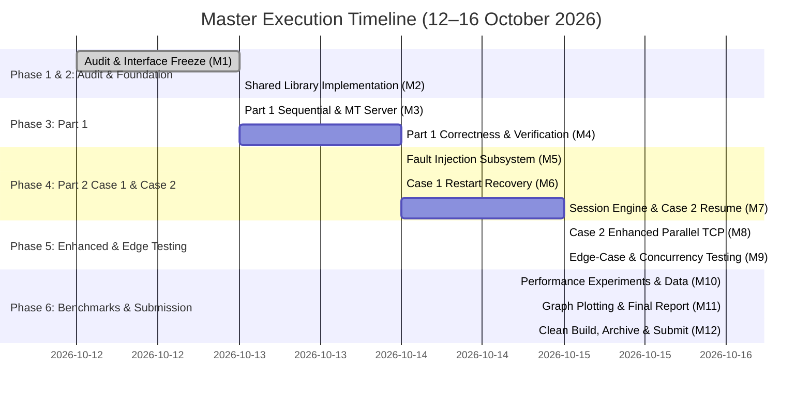

# MASTER PROJECT ROADMAP: PHASED IMPLEMENTATION PLAN
**Course**: IT305 Computer Networks Lab (Autumn 2026)  
**Project**: Fault-Tolerant Topic-Based File Distribution Service  
**Execution Window**: 12 October 2026 – 16 October 2026  
**Final Submission Deadline**: 16 October 2026 (23:59 IST)  

---

## 1. Phased Milestone Timeline

---

## 2. Master Task Catalog

Every task is designed to be independently executable and verifiable.

---

### Phase 1: Repository Audit & Protocol Freeze
**Target Completion**: 13 October 2026 (02:00 IST)

#### `TSK-P01-01`: Repository Bootstrap & Documentation Setup
- **Phase & Milestone**: Phase 1 / Milestone M1
- **Priority**: P0 (Blocker)
- **Assigned Owner**: Dharmraj Vaghela (202401236)
- **Reviewer**: Jay Vaghela (202401237)
- **Estimated Effort**: 2 hours
- **Objective**: Initialize Git repository structure, commit master roadmap documents, create `develop` branch, and protect `main`.
- **Deliverable**: Directory tree with `docs/roadmap/`, `.gitignore`, and initial commit on GitHub.
- **Files**: `.gitignore`, `docs/roadmap/*`
- **Prerequisites**: None.
- **Knowledge Required**: Git CLI, repository permissions.
- **Acceptance Criteria**: `git status` clean; `origin/main` and `origin/develop` branches visible on GitHub.
- **Test Procedure**: `git clone https://github.com/Dharmraj06/CN-Fault-Tolerant-Topic-based-File-Distribution-Service.git` on a clean directory succeeds.
- **Definition of Done**: PR merged to `main`, all 6 members can pull.
- **Branch**: `task/p01-repo-bootstrap` -> PR into `main`.
- **Risks**: Git authentication issues; solved by HTTPS token setup.

---

### Phase 2: Shared Socket & File Infrastructure
**Target Completion**: 13 October 2026 (14:00 IST)

#### `TSK-P02-01`: Core Framing & Socket Helper Routines
- **Phase & Milestone**: Phase 2 / Milestone M2
- **Priority**: P0 (Blocker)
- **Assigned Owner**: Jay Vaghela (202401237)
- **Reviewer**: Vivek Dodiya (202401253)
- **Estimated Effort**: 4 hours
- **Objective**: Implement `protocol.c` with robust `send_all()`, `recv_all()`, `send_frame()`, and `recv_frame()` handling arbitrary partial I/O.
- **Deliverable**: Tested `common/protocol.h` and `common/protocol.c`.
- **Files**: `common/protocol.h`, `common/protocol.c`, `tests/test_protocol.c`
- **Prerequisites**: `TSK-P01-01`
- **Knowledge Required**: POSIX sockets, network byte order, endianness conversions.
- **Acceptance Criteria**: Handles 1-byte simulated partial reads without corruption; correctly rejects invalid magic.
- **Test Procedure**: Run standalone unit test sending binary frames through loopback pair.
- **Definition of Done**: Clean unit test execution with zero memory leaks in Valgrind.
- **Branch**: `task/p02-protocol-engine` -> PR into `develop`.

#### `TSK-P02-02`: Topic Discovery & Manifest Builder
- **Phase & Milestone**: Phase 2 / Milestone M2
- **Priority**: P0 (Blocker)
- **Assigned Owner**: Jay Vaghela (202401237)
- **Reviewer**: Shlok Topaliya (202401229)
- **Estimated Effort**: 3 hours
- **Objective**: Implement directory scanner that filters regular files, sorts filenames lexicographically using `qsort`, validates path traversal attacks, and generates CRC32 manifest fingerprints.
- **Deliverable**: `common/topic_manager.h` and `common/topic_manager.c`.
- **Files**: `common/topic_manager.h`, `common/topic_manager.c`, `tests/test_topic.c`
- **Prerequisites**: `TSK-P01-01`
- **Knowledge Required**: POSIX `opendir()`, `readdir()`, `stat()`, string security.
- **Acceptance Criteria**: Rejects `../`, absolute paths, empty directories, and symlinks. Manifest order identical across repeated calls.
- **Test Procedure**: Run test harness against sample topic directory with 20 dummy files.
- **Definition of Done**: Unit test passes, path traversal blocked.
- **Branch**: `task/p02-topic-manager` -> PR into `develop`.

#### `TSK-P02-03`: Bounded File I/O & Disk Transfer Routines
- **Phase & Milestone**: Phase 2 / Milestone M2
- **Priority**: P0 (Blocker)
- **Assigned Owner**: Vivek Dodiya (202401253)
- **Reviewer**: Jay Vaghela (202401237)
- **Estimated Effort**: 4 hours
- **Objective**: Implement chunked file streaming from offsets, atomic file writing with `pwrite()`, safe client path generation (`<output_dir>/<topic>/<file>`), and file size verification.
- **Deliverable**: `common/file_transfer.h` and `common/file_transfer.c`.
- **Files**: `common/file_transfer.h`, `common/file_transfer.c`, `tests/test_file_io.c`
- **Prerequisites**: `TSK-P01-01`
- **Knowledge Required**: POSIX `open()`, `read()`, `pwrite()`, `mkdir()`.
- **Acceptance Criteria**: Correctly streams binary image without loading entire file in RAM; `pwrite()` places bytes at exact offset.
- **Test Procedure**: Stream a 10MB test file to a temporary directory in 16KB chunks and verify `diff` returns 0.
- **Definition of Done**: Clean `diff`, passes Valgrind.
- **Branch**: `task/p02-file-transfer` -> PR into `develop`.

#### `TSK-P02-04`: Thread-Safe Logging & High-Precision Timing
- **Phase & Milestone**: Phase 2 / Milestone M2
- **Priority**: P1
- **Assigned Owner**: Shlok Topaliya (202401229)
- **Reviewer**: Yug Malaviya (202401256)
- **Estimated Effort**: 2.5 hours
- **Objective**: Implement thread-safe logging utility with `clock_gettime(CLOCK_MONOTONIC)` timing and formatted CSV output recording.
- **Deliverable**: `common/logging.h` and `common/logging.c`.
- **Files**: `common/logging.h`, `common/logging.c`
- **Prerequisites**: `TSK-P01-01`
- **Knowledge Required**: C varargs, `pthread_mutex_t`, monotonic clocks.
- **Acceptance Criteria**: Multi-threaded writes do not interleave log characters; CSV fields conform to specification.
- **Test Procedure**: Spawn 10 threads writing 100 log lines simultaneously; verify output line count.
- **Definition of Done**: Thread-safe execution confirmed.
- **Branch**: `task/p02-logging-timing` -> PR into `develop`.

---

### Phase 3: Part 1 Implementation (Sequential & Multi-Threaded)
**Target Completion**: 13 October 2026 (22:00 IST)

#### `TSK-P03-01`: Part 1 Single-Threaded Server
- **Phase & Milestone**: Phase 3 / Milestone M3
- **Priority**: P0 (Blocker)
- **Assigned Owner**: Jay Vaghela (202401237)
- **Reviewer**: Atharv Trivedi (202401230)
- **Estimated Effort**: 3.5 hours
- **Objective**: Implement single-threaded sequential server in `Part1/server.c` that accepts `./server <port> <topics_root_dir>`, serves one client at a time sequentially, and closes connection upon completion.
- **Deliverable**: `Part1/server.c`, `Part1/Makefile`.
- **Files**: `Part1/server.c`, `Part1/Makefile`
- **Prerequisites**: `TSK-P02-01`, `TSK-P02-02`, `TSK-P02-03`
- **Knowledge Required**: `socket()`, `bind()`, `listen()`, `accept()`.
- **Acceptance Criteria**: Running `make` produces `server`; accepts client, streams all files, and handles next client only after current completes.
- **Test Procedure**: `./server 8080 ../test_topics` -> run test client.
- **Definition of Done**: `Part1/server` builds and successfully distributes topic files sequentially.
- **Branch**: `task/p03-part1-seq-server` -> PR into `develop`.

#### `TSK-P03-02`: Part 1 Multi-Threaded Server
- **Phase & Milestone**: Phase 3 / Milestone M3
- **Priority**: P0 (Blocker)
- **Assigned Owner**: Jay Vaghela (202401237)
- **Reviewer**: Dharmraj Vaghela (202401236)
- **Estimated Effort**: 3 hours
- **Objective**: Extend/compile `Part1/server.c` to spawn a detached POSIX worker thread (`pthread_create`) for every accepted connection so the listener can immediately accept subsequent clients.
- **Deliverable**: Thread-per-client server in `Part1/server.c`.
- **Files**: `Part1/server.c`, `Part1/Makefile`
- **Prerequisites**: `TSK-P03-01`
- **Knowledge Required**: POSIX `pthreads`, `pthread_detach()`, re-entrant safety.
- **Acceptance Criteria**: Multiple clients download topics concurrently without blocking each other.
- **Test Procedure**: Launch 4 parallel client instances requesting different topics simultaneously.
- **Definition of Done**: Simultaneous file delivery verified, no zombie threads.
- **Branch**: `task/p03-part1-mt-server` -> PR into `develop`.

#### `TSK-P03-03`: Part 1 Client Implementation
- **Phase & Milestone**: Phase 3 / Milestone M3
- **Priority**: P0 (Blocker)
- **Assigned Owner**: Vivek Dodiya (202401253)
- **Reviewer**: Jay Vaghela (202401237)
- **Estimated Effort**: 3.5 hours
- **Objective**: Implement standard client in `Part1/client.c` accepting `./client <server_ip> <server_port> <topic> <output_dir>`, creating `<output_dir>/<topic>/`, and saving files.
- **Deliverable**: `Part1/client.c`, `Part1/Makefile`.
- **Files**: `Part1/client.c`, `Part1/Makefile`
- **Prerequisites**: `TSK-P02-01`, `TSK-P02-03`
- **Knowledge Required**: Client socket networking, directory hierarchy generation.
- **Acceptance Criteria**: Running `make` produces `client`; all topic files arrive intact and identical to server sources.
- **Test Procedure**: `diff -r <server_dir>/topic <output_dir>/topic` returns clean.
- **Definition of Done**: Byte-for-byte file fidelity confirmed.
- **Branch**: `task/p03-part1-client` -> PR into `develop`.

---

### Phase 4: Part 2 Case 1 (Fault Injection & Full Restart)
**Target Completion**: 14 October 2026 (14:00 IST)

#### `TSK-P04-01`: Fault Injection Module
- **Phase & Milestone**: Phase 4 / Milestone M5
- **Priority**: P0 (Blocker)
- **Assigned Owner**: Atharv Trivedi (202401230)
- **Reviewer**: Vivek Dodiya (202401253)
- **Estimated Effort**: 3 hours
- **Objective**: Implement `common/fault_injection.c` providing probability parsing `[0.0, 1.0]`, per-chunk failure evaluation, and abrupt socket closure.
- **Deliverable**: `common/fault_injection.h` and `common/fault_injection.c`.
- **Files**: `common/fault_injection.h`, `common/fault_injection.c`
- **Prerequisites**: `TSK-P01-01`
- **Knowledge Required**: Random number generators, POSIX socket shutdown/close semantics.
- **Acceptance Criteria**: With `prob=0.0`, zero failures occur; with `prob=1.0`, connection drops immediately on first chunk.
- **Test Procedure**: Unit test evaluating 10,000 decisions at `prob=0.25` yields empirical rate ~25% (+-1%).
- **Definition of Done**: Probabilistic distribution validated.
- **Branch**: `task/p04-fault-injector` -> PR into `develop`.

#### `TSK-P04-02`: Part 2 Case 1 Server Implementation
- **Phase & Milestone**: Phase 4 / Milestone M6
- **Priority**: P0 (Blocker)
- **Assigned Owner**: Atharv Trivedi (202401230)
- **Reviewer**: Dharmraj Vaghela (202401236)
- **Estimated Effort**: 3 hours
- **Objective**: Implement `Part2_Case1/server.c` accepting `./server <port> <topics_root_dir> <failure_probability>`, applying fault injection before chunks, and treating every reconnection as a brand new transfer.
- **Deliverable**: `Part2_Case1/server.c`, `Part2_Case1/Makefile`.
- **Files**: `Part2_Case1/server.c`, `Part2_Case1/Makefile`
- **Prerequisites**: `TSK-P03-02`, `TSK-P04-01`
- **Knowledge Required**: Integrating fault injection into worker thread streaming loop.
- **Acceptance Criteria**: Server abruptly drops connection when fault triggers; accepts reconnect and restarts from file 0, offset 0.
- **Test Procedure**: Test server with `prob=0.10` and verify client reconnect requests begin from file 0.
- **Definition of Done**: Case 1 server builds and drops connections as configured.
- **Branch**: `task/p04-case1-server` -> PR into `develop`.

#### `TSK-P04-03`: Part 2 Case 1 Client Implementation
- **Phase & Milestone**: Phase 4 / Milestone M6
- **Priority**: P0 (Blocker)
- **Assigned Owner**: Vivek Dodiya (202401253)
- **Reviewer**: Atharv Trivedi (202401230)
- **Estimated Effort**: 3.5 hours
- **Objective**: Implement `Part2_Case1/client.c` with abrupt disconnection detection, removal/truncation of incomplete files in `<output_dir>/<topic>/`, exponential backoff retry loop, and full topic restart.
- **Deliverable**: `Part2_Case1/client.c`, `Part2_Case1/Makefile`.
- **Files**: `Part2_Case1/client.c`, `Part2_Case1/Makefile`
- **Prerequisites**: `TSK-P03-03`
- **Knowledge Required**: Socket error detection (`ECONNRESET`, EOF), exponential backoff, file cleanup.
- **Acceptance Criteria**: Client survives multiple connection drops, restarts transfer from beginning, and only completes when all files are intact.
- **Test Procedure**: Run client against server with `prob=0.15`; verify successful transfer after retries with 100% `diff` accuracy.
- **Definition of Done**: Case 1 client resiliently recovers and verifies file tree.
- **Branch**: `task/p04-case1-client` -> PR into `develop`.

---

### Phase 5: Part 2 Case 2 (Session Management & Checkpoint Resume)
**Target Completion**: 14 October 2026 (23:00 IST)

#### `TSK-P05-01`: In-Memory Session & Checkpoint Engine
- **Phase & Milestone**: Phase 5 / Milestone M7
- **Priority**: P0 (Blocker)
- **Assigned Owner**: Dharmraj Vaghela (202401236)
- **Reviewer**: Jay Vaghela (202401237)
- **Estimated Effort**: 4.5 hours
- **Objective**: Implement `common/session.c` with thread-safe session table, 64-bit session ID generator, checkpoint commit on `CHUNK_ACK`, resume validation, and TTL eviction.
- **Deliverable**: `common/session.h` and `common/session.c`.
- **Files**: `common/session.h`, `common/session.c`, `tests/test_session.c`
- **Prerequisites**: `TSK-P01-01`
- **Knowledge Required**: Mutex locking, hash tables/arrays, state machines.
- **Acceptance Criteria**: Concurrent threads can create and update distinct sessions without deadlocks; stale sessions expire.
- **Test Procedure**: Multi-threaded unit test creating 50 sessions and committing 1000 checkpoints under contention.
- **Definition of Done**: Unit tests pass cleanly under Valgrind/Helgrind.
- **Branch**: `task/p05-session-engine` -> PR into `develop`.

#### `TSK-P05-02`: Part 2 Case 2 Server Implementation
- **Phase & Milestone**: Phase 5 / Milestone M7
- **Priority**: P0 (Blocker)
- **Assigned Owner**: Dharmraj Vaghela (202401236)
- **Reviewer**: Atharv Trivedi (202401230)
- **Estimated Effort**: 4 hours
- **Objective**: Implement `Part2_Case2/server.c` incorporating session table, emitting session IDs, handling `CHUNK_ACK` frames, validating resume requests, and seeking to authoritative checkpoints.
- **Deliverable**: `Part2_Case2/server.c`, `Part2_Case2/Makefile`.
- **Files**: `Part2_Case2/server.c`, `Part2_Case2/Makefile`
- **Prerequisites**: `TSK-P05-01`, `TSK-P04-01`, `TSK-P03-02`
- **Knowledge Required**: State reconciliation, file seeking with `lseek()`.
- **Acceptance Criteria**: Upon reconnect with valid `session_id`, server resumes streaming exactly from last acknowledged offset.
- **Test Procedure**: Inject failure at byte 30,000 of a 100,000-byte file; verify server resumes from byte 30,000 on reconnect.
- **Definition of Done**: Zero redundant bytes sent for acknowledged data prefixes.
- **Branch**: `task/p05-case2-server` -> PR into `develop`.

#### `TSK-P05-03`: Part 2 Case 2 Client Implementation
- **Phase & Milestone**: Phase 5 / Milestone M7
- **Priority**: P0 (Blocker)
- **Assigned Owner**: Atharv Trivedi (202401230)
- **Reviewer**: Dharmraj Vaghela (202401236)
- **Estimated Effort**: 4 hours
- **Objective**: Implement `Part2_Case2/client.c` recording local checkpoints, sending `CHUNK_ACK` after every disk write, and transmitting `session_id` and checkpoint upon reconnecting.
- **Deliverable**: `Part2_Case2/client.c`, `Part2_Case2/Makefile`.
- **Files**: `Part2_Case2/client.c`, `Part2_Case2/Makefile`
- **Prerequisites**: `TSK-P05-01`, `TSK-P04-03`
- **Knowledge Required**: File seeking, checkpoint state tracking, resume handshake.
- **Acceptance Criteria**: Client successfully resumes interrupted downloads without re-downloading completed files or chunks.
- **Test Procedure**: Test with `prob=0.15`; verify total downloaded bytes is significantly lower than Case 1.
- **Definition of Done**: Case 2 client resumes seamlessly and verifies final files.
- **Branch**: `task/p05-case2-client` -> PR into `develop`.

---

### Phase 6: Part 2 Case 2 Enhanced (Parallel TCP Connections)
**Target Completion**: 15 October 2026 (16:00 IST)

#### `TSK-P06-01`: Parallel Work Partitioning Module
- **Phase & Milestone**: Phase 6 / Milestone M8
- **Priority**: P0 (Blocker)
- **Assigned Owner**: Shlok Topaliya (202401229)
- **Reviewer**: Dharmraj Vaghela (202401236)
- **Estimated Effort**: 3.5 hours
- **Objective**: Implement `common/work_plan.c` that slices topic manifests into work units (distinct files or chunk-aligned byte ranges) and assigns them to multiple TCP connections.
- **Deliverable**: `common/work_plan.h` and `common/work_plan.c`.
- **Files**: `common/work_plan.h`, `common/work_plan.c`, `tests/test_work_plan.c`
- **Prerequisites**: `TSK-P02-02`
- **Knowledge Required**: Work queue partitioning, range calculation.
- **Acceptance Criteria**: Correctly partitions topics with fewer files than connections by splitting large files into non-overlapping byte ranges.
- **Test Procedure**: Partition a topic with 3 files across 4 connections; verify zero overlap in assigned byte intervals.
- **Definition of Done**: Non-overlapping interval safety verified.
- **Branch**: `task/p06-work-plan` -> PR into `develop`.

#### `TSK-P06-02`: Part 2 Case 2 Enhanced Server & Client
- **Phase & Milestone**: Phase 6 / Milestone M8
- **Priority**: P0 (Blocker)
- **Assigned Owner**: Shlok Topaliya (202401229)
- **Reviewer**: Vivek Dodiya (202401253)
- **Estimated Effort**: 5.5 hours
- **Objective**: Implement `Part2_Case2_Enhanced/server.c` and `Part2_Case2_Enhanced/client.c`. Client supports optional trailing connection count (defaulting to 1). Coordinator manages worker socket threads and writes chunks using `pwrite()`.
- **Deliverable**: `Part2_Case2_Enhanced/server.c`, `client.c`, `Makefile`.
- **Files**: `Part2_Case2_Enhanced/server.c`, `client.c`, `Makefile`
- **Prerequisites**: `TSK-P06-01`, `TSK-P05-02`, `TSK-P05-03`
- **Knowledge Required**: Multi-socket client architecture, `pwrite()`, thread barriers.
- **Acceptance Criteria**: Invocation `./client <ip> <port> <topic> <out_dir>` works as standard 1-connection; `./client ... [conns]` scales across multiple sockets; all files match 100%.
- **Test Procedure**: Download topic across 4 connections with `prob=0.10`; confirm clean `diff -r` and faster completion time.
- **Definition of Done**: Parallel transfer and per-connection recovery fully working.
- **Branch**: `task/p06-case2-enhanced` -> PR into `develop`.

---

### Phase 7: Edge Case Testing & Benchmark Automation
**Target Completion**: 16 October 2026 (04:00 IST)

#### `TSK-P07-01`: Automated Correctness & Edge Case Test Suite
- **Phase & Milestone**: Phase 7 / Milestone M9
- **Priority**: P0 (Blocker)
- **Assigned Owner**: Yug Malaviya (202401256)
- **Reviewer**: Atharv Trivedi (202401230)
- **Estimated Effort**: 4 hours
- **Objective**: Implement comprehensive bash test scripts testing: empty topics, empty files, large files (50MB+), special filename characters, invalid topics, path traversal attempts, port errors, and unexpected disconnects across all 4 directories.
- **Deliverable**: `scripts/test_all_correctness.sh`.
- **Files**: `scripts/test_all_correctness.sh`, `scripts/generate_test_dataset.sh`
- **Prerequisites**: All implementation tasks (Phases 3–6)
- **Knowledge Required**: Bash scripting, Linux CLI, test automation.
- **Acceptance Criteria**: Script runs automated regression suite across all 4 folders and prints summary `PASS` on 100% of test cases.
- **Test Procedure**: `./scripts/test_all_correctness.sh`
- **Definition of Done**: 100% pass rate achieved on local and multi-host environments.
- **Branch**: `task/p07-correctness-suite` -> PR into `develop`.

#### `TSK-P07-02`: Benchmark Experiment Runner & Data Collection
- **Phase & Milestone**: Phase 7 / Milestone M10
- **Priority**: P0 (Blocker)
- **Assigned Owner**: Yug Malaviya (202401256)
- **Reviewer**: Shlok Topaliya (202401229)
- **Estimated Effort**: 4.5 hours
- **Objective**: Implement Python/Bash benchmark harness to automate the experimental matrix: Part 1 sequential vs MT across 1, 2, 4, 8 clients; Case 1 vs Case 2 across failure probabilities 0%, 1%, 5%, 10%; Case 2 vs Enhanced across 1, 2, 4 connections. Collect clean raw CSVs into `Results/`.
- **Deliverable**: `scripts/run_benchmarks.py`, raw CSV logs in `Results/`.
- **Files**: `scripts/run_benchmarks.py`, `Results/*.csv`
- **Prerequisites**: `TSK-P07-01`
- **Knowledge Required**: Python `subprocess`, socket scripting, CSV handling.
- **Acceptance Criteria**: Generates reproducible raw CSV datasets with exact byte counts, elapsed times, and throughputs.
- **Test Procedure**: Execute full experiment suite across 3 test nodes / loopback.
- **Definition of Done**: All required raw CSV data populated in `Results/`.
- **Branch**: `task/p07-benchmark-runner` -> PR into `develop`.

---

### Phase 8: Results Visualization, Final Report & Submission
**Target Completion**: 16 October 2026 (20:00 IST)

#### `TSK-P08-01`: Graph Plotting Subsystem
- **Phase & Milestone**: Phase 8 / Milestone M11
- **Priority**: P0 (Blocker)
- **Assigned Owner**: Shlok Topaliya (202401229)
- **Reviewer**: Yug Malaviya (202401256)
- **Estimated Effort**: 3 hours
- **Objective**: Implement Python Matplotlib plotting script to convert raw CSV data into publication-quality graphs: `Part1_throughput.png`, `Case1_vs_Case2_throughput.png`, `Case1_vs_Case2_overhead.png`, `Enhanced_speedup.png`.
- **Deliverable**: `scripts/plot_results.py`, high-resolution PNGs in `Results/`.
- **Files**: `scripts/plot_results.py`, `Results/*.png`
- **Prerequisites**: `TSK-P07-02`
- **Knowledge Required**: Python `matplotlib`, `pandas`/`csv`.
- **Acceptance Criteria**: Clean, clearly labeled axes, units (MB/s, sec, %), legends, and error bars.
- **Test Procedure**: `python3 scripts/plot_results.py` generates all required images.
- **Definition of Done**: Graphs generated and inspected for visual clarity.
- **Branch**: `task/p08-plot-results` -> PR into `develop`.

#### `TSK-P08-02`: Consolidated Final Report (`FinalReport_Group_071_072.pdf`)
- **Phase & Milestone**: Phase 8 / Milestone M11
- **Priority**: P0 (Blocker)
- **Assigned Owner**: Yug Malaviya (202401256)
- **Reviewer**: All Team Members
- **Estimated Effort**: 5 hours
- **Objective**: Author consolidated PDF report containing: Cover page with Group numbers (071 + 072), member names, roll numbers, individual contribution statements, design details, deviations from design doc, embedded performance graphs, and rigorous result analysis.
- **Deliverable**: `FinalReport_Group_071_072.pdf`.
- **Files**: `docs/report/report.tex` (or Markdown), `FinalReport_Group_071_072.pdf`
- **Prerequisites**: `TSK-P08-01`
- **Knowledge Required**: Technical writing, LaTeX/Pandoc PDF compilation.
- **Acceptance Criteria**: Satisfies every point on the instructor assignment checklist; includes all 6 contribution statements.
- **Test Procedure**: Visual inspection of PDF formatting and graph embeds.
- **Definition of Done**: Final PDF built, reviewed, and signed off by all 6 members.
- **Branch**: `task/p08-final-report` -> PR into `develop`.

#### `TSK-P08-03`: Packaging, Clean Build Verification & Submission Archive
- **Phase & Milestone**: Phase 8 / Milestone M12
- **Priority**: P0 (Blocker)
- **Assigned Owner**: Dharmraj Vaghela (202401236)
- **Reviewer**: Jay Vaghela (202401237)
- **Estimated Effort**: 2.5 hours
- **Objective**: Implement packaging script that validates clean builds in fresh environment, verifies CLI parameters, builds root `README.md`, and generates `FinalSubmission_Group_071_072.zip`.
- **Deliverable**: `scripts/package_submission.sh`, `FinalSubmission_Group_071_072.zip`.
- **Files**: `scripts/package_submission.sh`, `README.md`, `FinalSubmission_Group_071_072.zip`
- **Prerequisites**: All previous tasks
- **Knowledge Required**: Bash, zip/tar, automated grader validation.
- **Acceptance Criteria**: Archive contains exact folder hierarchy; running `make` in each folder produces `server` and `client`; zero compilation warnings.
- **Test Procedure**: Extract archive in clean VM/directory and run auto-test script.
- **Definition of Done**: Verified archive submitted to portal before 16 October 23:59.
- **Branch**: `task/p08-packaging` -> PR into `main`.
