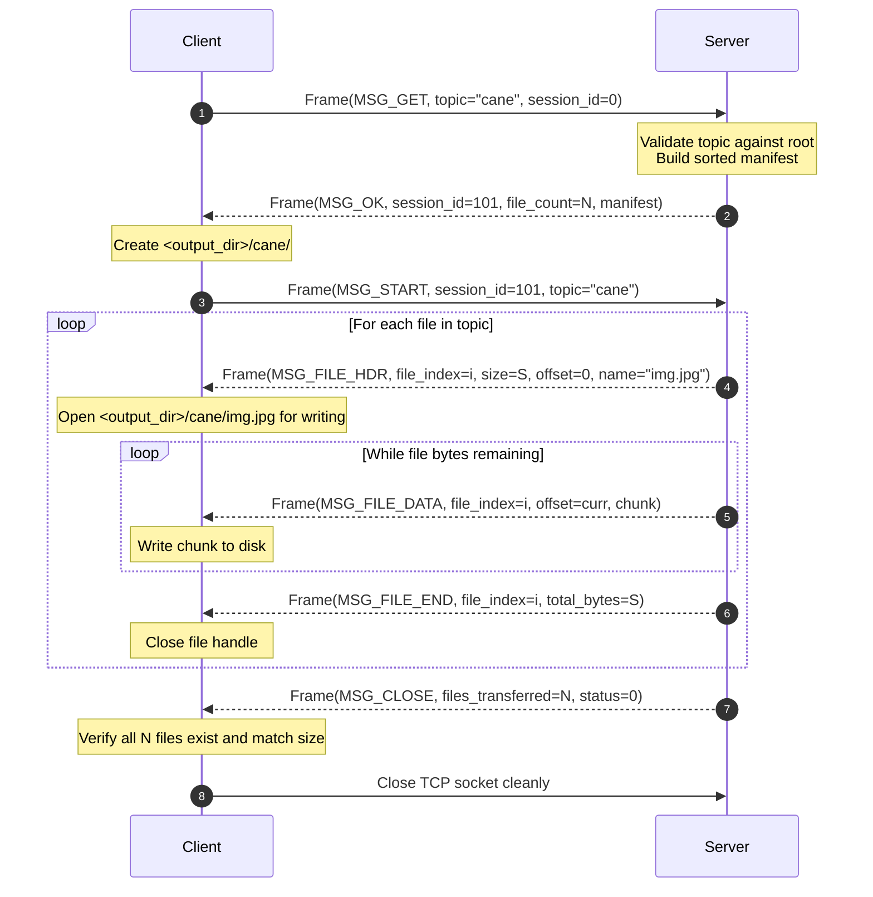
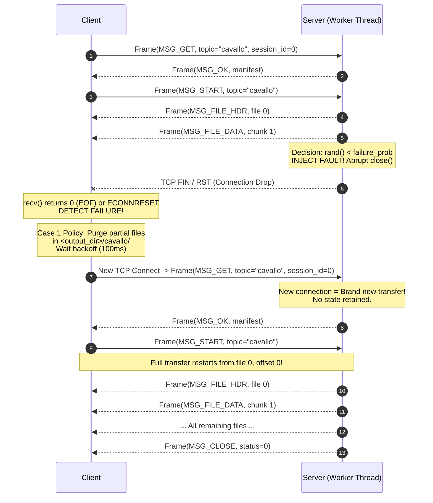
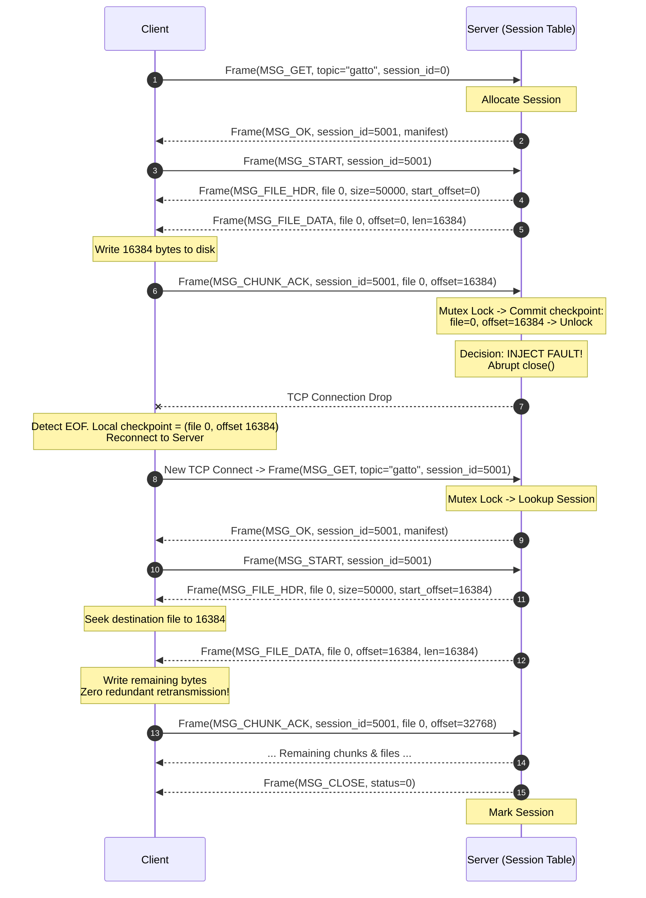
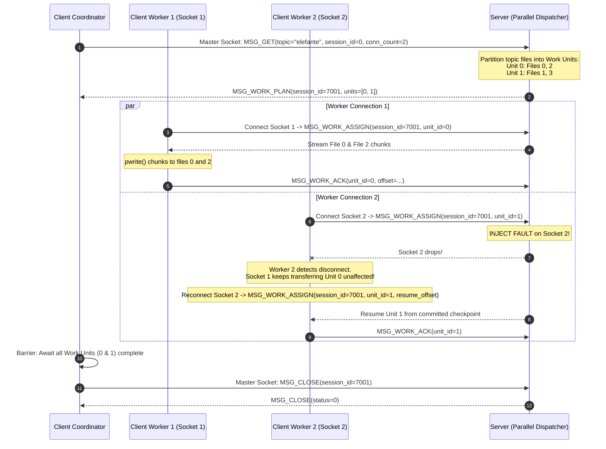

# PROTOCOL SPECIFICATION: APPLICATION WIRE PROTOCOL
**Course**: IT305 Computer Networks Lab (Autumn 2026)  
**Document**: Wire Protocol & Framing Specification for Fault-Tolerant Topic-Based File Distribution Service  
**Target Architecture**: POSIX C (C11/C99), Linux / Unix TCP Sockets  

---

## 1. TCP Byte-Stream Realities & Framing Philosophy

TCP is a reliable, stream-oriented transport protocol (`SOCK_STREAM`). It guarantees that bytes arrive in order and without duplicates, but it **does not preserve application message boundaries**:
- A single `send(1024)` on the server may arrive at the client across multiple `recv()` calls (e.g., 400 bytes, then 624 bytes).
- Multiple small `send()` calls on the server may be coalesced by Nagle's algorithm and delivered in a single `recv()` call.
- Binary files (JPEG, PNG, ELF, compressed archives) may contain arbitrary byte sequences, including `\n`, `\r\n`, `\0`, or byte patterns that resemble delimiters.

Therefore, delimiter-based framing (such as line-oriented protocols) is strictly prohibited. The system uses **explicit binary length framing**. Every protocol message begins with a fixed-size 16-byte header containing an exact 64-bit payload length. The receiver reads exactly 16 bytes first, decodes the payload length, and then loops until exactly `payload_len` bytes are received.

---

## 2. Fixed Frame Header Structure

Every transmission on the socket begins with the immutable 16-byte header:

```c
#pragma pack(push, 1)
typedef struct {
    uint16_t magic;         /* Protocol Magic: 0x5446 ('TF' in ASCII) */
    uint8_t  version;       /* Protocol Version: 0x01 */
    uint8_t  type;          /* Message Type ID (FrameType enum) */
    uint16_t flags;         /* Bitwise flags (e.g., FLAG_COMPRESSED, FLAG_CONFLICT) */
    uint16_t sequence_id;   /* Transaction / Sequence counter */
    uint64_t payload_len;   /* Exact payload length in bytes (excluding 16-byte header) */
} FrameHeader;
#pragma pack(pop)
```

### 2.1 Header Field Definitions

| Field | Size | Byte Order | Value / Constraints | Description |
| :--- | :--- | :--- | :--- | :--- |
| `magic` | 2 bytes | Network (Big Endian) | `0x5446` (`'TF'`) | Validates that incoming stream belongs to this application protocol. Frames with invalid magic are rejected immediately. |
| `version` | 1 byte | Native | `0x01` | Protocol version 1.0. Prevents protocol version mismatch. |
| `type` | 1 byte | Native | `0x01` to `0x1F` | Identifies the semantic purpose and payload layout of the frame. |
| `flags` | 2 bytes | Network (Big Endian) | Bitmask | Bit 0: `FLAG_LAST_CHUNK` (0x0001)<br>Bit 1: `FLAG_CONFLICT` (0x0002)<br>Bit 2: `FLAG_RESUME` (0x0004) |
| `sequence_id` | 2 bytes | Network (Big Endian) | `0x0000` to `0xFFFF` | Transaction identifier / message sequence number matching request and response. |
| `payload_len` | 8 bytes | Network (Big Endian) | `0` to `MAX_FRAME_PAYLOAD` | Explicit byte count of the immediately following payload buffer. |

### 2.2 Endianness Conversion
All multi-byte numeric fields in headers and binary payloads must be converted using standard POSIX network conversion functions:
- 16-bit: `htons()` / `ntohs()`
- 32-bit: `htonl()` / `ntohl()`
- 64-bit: Custom portable 64-bit converter:
```c
static inline uint64_t hton64(uint64_t val) {
#if __BYTE_ORDER__ == __ORDER_LITTLE_ENDIAN__
    return (((uint64_t)htonl((uint32_t)(val & 0xFFFFFFFF))) << 32) |
           (uint64_t)htonl((uint32_t)(val >> 32));
#else
    return val;
#endif
}
#define ntoh64(val) hton64(val)
```

---

## 3. Message Types & Numerical Identifiers

```c
typedef enum {
    /* Handshake and Control (Part 1, Part 2) */
    MSG_GET              = 0x01,  /* Client -> Server: Request topic transfer */
    MSG_OK               = 0x02,  /* Server -> Client: Topic accepted, manifest returned */
    MSG_START            = 0x03,  /* Client -> Server: Client ready to receive */
    MSG_ERROR            = 0x04,  /* Either -> Either: Typed error code & text */
    MSG_CLOSE            = 0x05,  /* Either -> Either: Graceful topic closure */
    
    /* File Streaming (All Parts) */
    MSG_FILE_HDR         = 0x06,  /* Server -> Client: File metadata & transfer boundaries */
    MSG_FILE_DATA        = 0x07,  /* Server -> Client: Raw binary file chunk */
    MSG_FILE_END         = 0x08,  /* Server -> Client: File boundary marker & checksum */
    
    /* Case 2 Session & Checkpoint Control */
    MSG_CHUNK_ACK        = 0x09,  /* Client -> Server: Checkpoint acknowledgment for chunk */
    MSG_SESSION_RESUME   = 0x0A,  /* Client -> Server: Request resume with session ID & checkpoint */
    MSG_RESUME_ACCEPT    = 0x0B,  /* Server -> Client: Authoritative resume boundaries returned */
    MSG_RESUME_REJECT    = 0x0C,  /* Server -> Client: Resume rejected (expired/changed) */

    /* Case 2 Enhanced Parallel Connections */
    MSG_WORK_PLAN        = 0x10,  /* Server -> Client: Full partitioning plan of work units */
    MSG_WORK_ASSIGN      = 0x11,  /* Server -> Client: Specific work unit assignment for socket */
    MSG_WORK_DATA        = 0x12,  /* Server -> Client: Chunk tagged with unit_id */
    MSG_WORK_ACK         = 0x13,  /* Client -> Server: Checkpoint acknowledgment for unit_id */
    MSG_WORK_END         = 0x14   /* Server -> Client: Completion confirmation for work unit */
} FrameType;
```

---

## 4. Frame Payload Wire Formats

### 4.1 `MSG_GET` (Type 0x01) — Client to Server
Initiates a topic request.
```c
#pragma pack(push, 1)
typedef struct {
    uint64_t session_id;               /* 0 for initial transfer, non-zero for Case 2 resume */
    uint16_t topic_len;                /* Length of topic string (excluding null terminator) */
    char     topic[MAX_TOPIC_NAME];    /* Topic identifier (e.g. "cane", "gatto") */
} PayloadGet;
#pragma pack(pop)
```

### 4.2 `MSG_OK` (Type 0x02) — Server to Client
Accepts topic request, returns session ID and sorted file manifest.
```c
#pragma pack(push, 1)
typedef struct {
    uint64_t session_id;               /* Unique 64-bit session ID assigned by server */
    uint32_t manifest_fingerprint;     /* CRC32 or hash of topic files and sizes */
    uint32_t file_count;               /* Number of regular files in topic */
    uint64_t total_topic_bytes;        /* Sum of all file sizes in bytes */
} PayloadOkHeader;

typedef struct {
    uint32_t file_index;               /* 0-indexed file sequence in topic */
    uint64_t file_size;                /* Total file size in bytes */
    uint16_t name_len;                 /* Length of filename */
    char     filename[MAX_FILENAME];   /* Relative file name (e.g. "OIP-10.jpg") */
} WireFileEntry;
#pragma pack(pop)
```
*Note*: The total `payload_len` of `MSG_OK` is `sizeof(PayloadOkHeader) + sum(sizeof(WireFileEntry))`.

### 4.3 `MSG_START` (Type 0x03) — Client to Server
Signals that client has created the topic directory `<output_dir>/<topic>/` and is ready to stream.
```c
#pragma pack(push, 1)
typedef struct {
    uint64_t session_id;               /* Session ID confirmed by client */
    char     topic[MAX_TOPIC_NAME];    /* Topic echoed back for consistency */
} PayloadStart;
#pragma pack(pop)
```

### 4.4 `MSG_FILE_HDR` (Type 0x06) — Server to Client
Sent before streaming each file's data chunks.
```c
#pragma pack(push, 1)
typedef struct {
    uint32_t file_index;               /* Index matching manifest */
    uint64_t file_size;                /* Total file size */
    uint64_t start_offset;             /* 0 for new transfer; > 0 for Case 2 resumed transfer */
    uint16_t name_len;                 /* Filename length */
    char     filename[MAX_FILENAME];   /* Clean filename */
} PayloadFileHeader;
#pragma pack(pop)
```

### 4.5 `MSG_FILE_DATA` (Type 0x07) — Server to Client
Carries one bounded slice of raw file bytes.
```c
#pragma pack(push, 1)
typedef struct {
    uint32_t file_index;               /* Index of file being streamed */
    uint64_t offset;                   /* Byte offset where this chunk begins in the file */
    uint32_t chunk_len;                /* Byte length of raw data following this struct */
    /* uint8_t data[chunk_len]; */    /* Raw file bytes immediately follow */
} PayloadFileDataHeader;
#pragma pack(pop)
```

### 4.6 `MSG_CHUNK_ACK` (Type 0x09) — Client to Server (Case 2 Checkpoint)
Sent by client immediately after disk write is confirmed.
```c
#pragma pack(push, 1)
typedef struct {
    uint64_t session_id;               /* Active session identifier */
    uint32_t file_index;               /* File index just written */
    uint64_t committed_offset;         /* Offset reached (start offset + chunk_len) */
    uint32_t chunk_crc32;              /* Optional CRC32 of chunk for data integrity */
} PayloadChunkAck;
#pragma pack(pop)
```

### 4.7 `MSG_FILE_END` (Type 0x08) — Server to Client
Marks boundary of completed file.
```c
#pragma pack(push, 1)
typedef struct {
    uint32_t file_index;               /* Completed file index */
    uint64_t total_bytes_sent;         /* Total bytes sent for this file */
} PayloadFileEnd;
#pragma pack(pop)
```

### 4.8 `MSG_CLOSE` / `TRANSFER_END` (Type 0x05) — Server to Client
Confirms all files of topic have been delivered.
```c
#pragma pack(push, 1)
typedef struct {
    uint64_t session_id;               /* Completed session ID */
    uint32_t files_transferred;        /* Total regular files delivered */
    uint64_t total_useful_bytes;       /* Total file bytes delivered */
    uint32_t status_code;              /* 0 for OK, non-zero for error */
} PayloadClose;
#pragma pack(pop)
```

### 4.9 `MSG_ERROR` (Type 0x04) — Either Direction
```c
#pragma pack(push, 1)
typedef struct {
    uint32_t error_code;               /* ProtocolErrorCode enum */
    uint16_t message_len;              /* Diagnostic text length */
    char     message[256];             /* Human-readable diagnostic string */
} PayloadError;
#pragma pack(pop)
```

---

## 5. Protocol Error Codes

```c
typedef enum {
    ERR_NONE                = 0,
    ERR_INVALID_MAGIC       = 1001,
    ERR_INVALID_VERSION     = 1002,
    ERR_MALFORMED_FRAME     = 1003,
    ERR_INVALID_TOPIC_NAME  = 1004, /* Path traversal (contains '/', '..', etc.) */
    ERR_TOPIC_NOT_FOUND     = 1005, /* Topic directory does not exist under root */
    ERR_FILE_ACCESS_DENIED  = 1006, /* File permission or open failure */
    ERR_SESSION_NOT_FOUND   = 2001, /* Session ID unknown */
    ERR_SESSION_EXPIRED     = 2002, /* Session TTL elapsed */
    ERR_CHECKPOINT_CONFLICT = 2003, /* Client offset ahead of server authority */
    ERR_OFFSET_OUT_OF_BOUNDS= 2004, /* Requested offset > file size */
    ERR_MANIFEST_CHANGED    = 2005, /* Topic files modified between reconnections */
    ERR_DISK_WRITE_FAILED   = 3001, /* Client disk full / write error */
    ERR_INTERNAL_SERVER     = 4001
} ProtocolErrorCode;
```

---

## 6. Sequence Diagrams

### 6.1 Part 1: Baseline Single-Threaded & Multi-Threaded Transfer



### 6.2 Part 2 Case 1: Fault Injection & Full Topic Restart



### 6.3 Part 2 Case 2: Session Management & Checkpoint Resume



### 6.4 Part 2 Case 2 Enhanced: Parallel TCP Connections with Independent Work Units



---

## 7. Robust Socket I/O Routines

To guarantee partial read/write safety, all network I/O must use these verified helper routines:

```c
/* Send exactly count bytes or return -1 on error */
ssize_t send_all(int sockfd, const void *buf, size_t count) {
    size_t total_sent = 0;
    const char *ptr = (const char *)buf;
    while (total_sent < count) {
        ssize_t n = send(sockfd, ptr + total_sent, count - total_sent, MSG_NOSIGNAL);
        if (n < 0) {
            if (errno == EINTR) continue;
            return -1; /* Socket disconnected or error */
        }
        if (n == 0) return total_sent;
        total_sent += n;
    }
    return (ssize_t)total_sent;
}

/* Receive exactly count bytes or return 0 on EOF, -1 on error */
ssize_t recv_all(int sockfd, void *buf, size_t count) {
    size_t total_received = 0;
    char *ptr = (char *)buf;
    while (total_received < count) {
        ssize_t n = recv(sockfd, ptr + total_received, count - total_received, 0);
        if (n < 0) {
            if (errno == EINTR) continue;
            return -1; /* Socket error */
        }
        if (n == 0) return 0; /* Orderly connection close (EOF) */
        total_received += n;
    }
    return (ssize_t)total_received;
}
```
